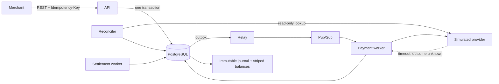

# FlowLedger

**A payment orchestrator that never guesses whether money moved.**

When a payment provider times out after you sent the request, you do not know whether it charged the card. Most systems resolve that by retrying, or by calling it a failure and moving on. Both can create a duplicate charge or a lost one, and neither leaves a record of the guess.

FlowLedger makes ambiguity a first-class state. A possibly-transmitted write becomes `UNKNOWN`, posts nothing to the ledger, blocks what it must block, and is resolved only by read-only provider evidence — a lookup, a signed webhook, or an operator with proof. If evidence never arrives, the operation surfaces as `REQUIRES_REVIEW` rather than silently resolving itself.

Everything else in the system exists to make that guarantee hold: an immutable double-entry ledger, effectively-once business effects over at-least-once infrastructure, and recovery paths defined for every crash point.

It is a sandbox project. It never touches real cardholder data and never holds real funds.

## Status

**Contracts are complete; application code has not been written yet.**

Every number below is a target, not a measurement. The implementation plan gates each claim behind evidence, and until a benchmark produces that evidence the claim stays labeled as a target. Nothing here should be read as a measured result.

## What is worth looking at

If you have five minutes, read these three:

1. **[ADR index](docs/01-ARCHITECTURE.md#architecture-decisions)** — twelve decisions, each with the alternatives that were rejected and why. The contestable ones are deliberately the ones written down: read-only ambiguity resolution, striped ledger accounts, reserved refund amounts, `If-Match` in the idempotency hash.
2. **[Payment state machine](docs/03-PAYMENT_STATE_MACHINE.md)** — why there is no single status enum, how operations carry ambiguity so confirmed money never does, and the exclusion model that lets refunds run concurrently while authorization and capture do not.
3. **[Money and ledger contract](docs/02-MONEY_AND_LEDGER_CONTRACT.md)** — the posting invariants, the fee arithmetic with no floating point, and the account striping that keeps two shared platform rows from serializing the entire ledger.

## The three engineering problems this project is built around

### Ambiguity without guessing

A write that may have been transmitted is never retried blind. `UNKNOWN` resolves only through read-only evidence, and the one exception requires typed proof that the previous attempt had no effect. Providers that document same-key replay are conformance-tested but never trusted to recover an ambiguous write, because a silently expired idempotency window turns that retry into a second charge. — [ADR-0004](docs/adr/0004-read-only-ambiguity-resolution.md)

### Ledger contention as a measured result

Every capture and refund debits one platform receivable account and credits one platform fee-revenue account. With a single row per account, those two rows are locked by every capture and refund in the deployment, which caps ledger throughput no matter how traffic is distributed. FlowLedger stripes them into deterministic buckets keyed by payment ID.

The benchmark reports the same workload at one bucket and at thirty-two, with the lock-wait distribution for both. The point is the controlled comparison, not the absolute number — a negative result gets published too. — [ADR-0010](docs/adr/0010-striped-clearing-accounts.md)

### Over-refund prevention where it belongs

Refunds may be in flight concurrently, each reserving its amount on the payment aggregate. The bound is `refunded + reserved <= captured`, evaluated under the payment row lock and backed by a database check constraint.

This is deliberate placement. An index permitting one unresolved refund at a time would make the over-refund property a uniqueness artifact and leave the monetary guard unreachable under concurrency — the test would prove an index works, not that the money rule does. — [ADR-0003](docs/adr/0003-exclusive-operations-and-reserved-refunds.md)

## Targets

Measured separately per boundary, never combined into one "payment latency" number.

| Boundary | Target |
| --- | --- |
| Durable command acceptance | ≥ 1,000 commands/s, p95 < 100 ms, p99 < 250 ms |
| Confirmed capture/refund processing | ≥ 500 operations/s, p95 internal < 250 ms |
| Outbox publication | ≥ 2,000 envelopes/s, p95 unpublished age < 2 s |
| Duplicate financial effects | 0 |

`duplicate_financial_effects_total` has an explicit definition rather than an implied one. It is not a count of journal rows sharing an operation ID — a unique index makes that impossible, so the metric would read zero without proving anything. It is a cross-system comparison against the simulated provider's ground truth, specified in the [test plan](docs/09-TEST_AND_PERFORMANCE_PLAN.md#defining-duplicate_financial_effects_total). A metric that cannot be nonzero is not evidence.

## Deliberate limits

Stated here rather than left for a reviewer to discover:

- **No real-provider adapter.** The interface, capability model, and conformance suite are built for one; only the implementation is deferred. The payoff is that every test, chaos workload, and benchmark runs offline from a clean clone, and that timeouts-after-commit can be injected deterministically. A real sandbox can do neither. — [ADR-0011](docs/adr/0011-simulated-providers-only-in-mvp.md)
- **Settlement is internal to the ledger.** Captures and refunds accumulate in a merchant clearing position and are closed into immutable batches that move value to merchant payable. No bank rails, no payout, no file formats. — [ADR-0012](docs/adr/0012-ledger-only-settlement.md)
- **Single region, one currency, one capture per authorization.** Multi-region writes, FX, chargebacks, multiple captures, and subscriptions are out of scope with contracts that do not pretend otherwise.
- **Retention archival and dual-approval operator tooling are specified but not built.** Nothing is deleted in the MVP, so deferring the archival jobs defers no correctness risk.
- **No PCI certification or regulatory compliance claim.** Synthetic payment methods and simulated providers only.

## Contract map

| Document | Purpose |
| --- | --- |
| [Scope and glossary](docs/00-SCOPE_AND_GLOSSARY.md) | Product boundary and canonical terminology |
| [Architecture](docs/01-ARCHITECTURE.md) | Components, ownership, transaction boundaries, ADR index |
| [Money and ledger](docs/02-MONEY_AND_LEDGER_CONTRACT.md) | Money, fee, posting, balance, striping, and settlement invariants |
| [Payment state machine](docs/03-PAYMENT_STATE_MACHINE.md) | Guards, versions, exclusion classes, ambiguity, expiry |
| [Event contracts](docs/04-EVENT_CONTRACTS.md) | Internal messages and signed merchant-webhook delivery |
| [API and idempotency](docs/05-API_AND_IDEMPOTENCY_CONTRACT.md) | HTTP commands, errors, replay, concurrency, timeline |
| [Provider contract](docs/06-PROVIDER_CONTRACT.md) | Adapter interface, normalized evidence, retries, webhooks |
| [Data model](docs/07-DATA_MODEL.md) | Tables, constraints, locks, protected functions, migrations |
| [Failure and recovery](docs/08-FAILURE_AND_RECOVERY.md) | Crash matrix, DLQs, reconciliation, runbooks, SLOs |
| [Test and performance](docs/09-TEST_AND_PERFORMANCE_PLAN.md) | Properties, workloads, invariant checker, evidence rules |
| [Implementation plan](docs/10-IMPLEMENTATION_PLAN.md) | Fourteen milestones, test gates, PR sequence, estimates |
| [OpenAPI](openapi/openapi.yaml) | Machine-readable HTTP contract |
| [JSON Schemas](schemas/README.md) | Strict internal message schemas and public webhook schema |

## Fixed design decisions

- TypeScript, Node.js, NestJS/Fastify, PostgreSQL, Google Pub/Sub, GCP.
- PostgreSQL is authoritative for payment state, immutable journal facts, idempotency, evidence, and durable work.
- Money-changing commands return `202 Accepted` only after operation, idempotency, state version, and outbox messages commit atomically.
- At-least-once transport is assumed. Database uniqueness, inboxes, stable provider keys, and idempotent posting provide effectively-once financial effects.
- Confirmed capture/refund effects and balanced ledger postings commit in one database transaction.
- Only protected `SECURITY DEFINER` functions may write payments, operations, journal rows, or balances. The application role holds no direct DML on them, which is what makes "the application *cannot* corrupt the ledger" testable rather than aspirational.
- The immutable journal is authoritative; synchronous balances are rebuildable and continuously audited.

## Normative rule

**MUST**, **MUST NOT**, **SHOULD**, and **MAY** use their RFC meanings. A change that alters money, state, idempotency, provider, event, or recovery behavior must update the relevant contract and machine schema before implementation.
