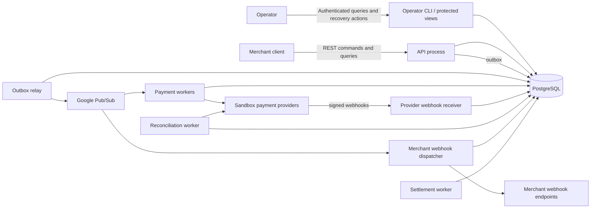

# Architecture

Status: **Draft**  
Last updated: 2026-11-05

## Architectural goals

FlowLedger MUST:

- Preserve financial correctness across retries, crashes, and duplicate delivery.
- Keep external provider ambiguity separate from confirmed internal facts.
- Scale API acceptance, provider execution, reconciliation, and webhook delivery independently.
- Make every business effect traceable from API request through provider interaction and journal posting.
- Provide a credible performance-testing surface without premature service fragmentation.

FlowLedger initially uses a **modular monolith with independently deployed processes**. Modules share one repository and PostgreSQL cluster, while the API, asynchronous workers, reconciler, and webhook dispatcher can run and scale separately.

## System context



## Deployable processes

| Process | Responsibilities | Scaling key |
| --- | --- | --- |
| API | Authentication, tenant resolution, validation, idempotent command acceptance, queries | Request rate |
| Outbox relay | Claim unpublished outbox rows and publish them to Pub/Sub | Outbox backlog |
| Payment worker | Execute provider operations and persist normalized outcomes | Provider and operation throughput |
| Provider webhook receiver | Verify signatures and durably ingest provider notifications | Webhook request rate |
| Reconciliation worker | Resolve unknown/stale operations and compare provider state | Unknown-operation backlog |
| Merchant webhook dispatcher | Sign and deliver merchant-facing events | Endpoint and delivery backlog |
| Settlement worker | Close eligible confirmed movements into immutable payout batches | Merchants due for settlement |

The MVP operator surface is separately authenticated CLI/read-only tooling over protected views and domain functions. It is not part of the merchant HTTP API and cannot select a merchant through an untrusted request header. A cross-tenant operator HTTP service is deferred until it has its own authentication, authorization, audit, and wire contract.

These processes MUST communicate through committed database state and versioned messages. They MUST NOT depend on in-memory state shared between process instances.

## Module ownership

### Payment module

Owns payments, operations, confirmed monetary totals, aggregate versions, transition guards, and idempotency records for payment commands.

### Ledger module

Owns accounts, striped platform clearing buckets, immutable journal transactions and entries, synchronous balances, reversal links, and ledger posting idempotency. No other module may insert journal entries directly.

### Settlement module

Owns settlement runs, posted batches, and immutable batch membership. It selects eligible confirmed movements, computes the net, and posts one balanced clearing-to-payable transaction through the ledger module's protected entry point. It never calls a provider, never locks a payment, and never moves value outside the system.

### Provider module

Owns the provider-neutral adapter interface, provider attempts, stable provider idempotency keys, normalized outcome classification, and capability declarations. Raw provider payloads are quarantined from domain models.

### Messaging module

Owns outbox/inbox records, serialization, schema validation, publication, redelivery handling, and dead-letter metadata.

### Reconciliation module

Owns schedules and comparison logic. It resolves existing operations through normal payment transitions; it does not repair payment or ledger state with direct SQL mutations.

### Webhook module

Owns merchant endpoint configuration, payload allowlists, signing, delivery attempts, and replay. Merchant webhooks are notifications, not a source of truth.

## Sources of truth

| Fact | Authoritative source | Derived/cache |
| --- | --- | --- |
| Accepted payment commands | PostgreSQL payment operations and idempotency records | API response cache |
| Confirmed payment state | PostgreSQL payment aggregate and terminal operations | Search/operator projections |
| External processor effect | Provider record, imported through a verified response, webhook, or reconciliation | Provider attempt records |
| Internal financial position | Immutable PostgreSQL journal entries | Synchronous account balance table; striped-bucket logical balance view; analytics projections |
| Settled merchant position | Immutable settlement batches plus their journal postings | Merchant payable balance row |
| Events awaiting publication | PostgreSQL outbox | Pub/Sub messages |
| Consumer application state | Consumer database transaction plus inbox record | In-memory handler state is non-authoritative |

The provider is authoritative about whether it executed an external payment action. The FlowLedger journal is authoritative about internal financial balances. A disagreement is a reconciliation incident, not permission to mutate one source to resemble the other without a recorded domain transition.

## Synchronous and asynchronous boundaries

### Synchronous

- `CreatePayment` validates and commits a payment without calling a provider, then returns `201 Created`.
- Query endpoints return confirmed state plus any active operation.
- Provider webhook ingestion verifies the signature, durably records a unique notification, and returns promptly.
- Ledger posting is synchronous inside the transaction that confirms a capture or refund.

### Asynchronous

- `Authorize`, `Capture`, `Cancel`, and `Refund` return `202 Accepted` once the idempotency record, operation, active-operation pointer, and outbox records commit.
- Provider execution occurs outside an API request.
- Event publication, merchant webhook delivery, reconciliation, settlement, analytics projections, and dead-letter recovery are asynchronous.

`202 Accepted` means **durably accepted for processing**, not provider success.

## Linearization points

A linearization point is the instant at which a business effect becomes committed and visible to concurrent operations.

| Effect | Linearization point | Database uniqueness boundary |
| --- | --- | --- |
| Payment creation | Commit of payment + idempotency record + outbox event | `(merchant_id, command_type, idempotency_key)` and payment ID |
| Provider-backed command acceptance | Commit of operation + active-operation pointer + payment version + idempotency record + requested event + execution command | API idempotency key and one-active-operation constraint |
| Provider attempt reservation | Commit that moves an operation from `REQUESTED` to `PROCESSING` and records its stable provider key | Operation ID and provider attempt identity |
| Confirmed authorization/cancellation | Commit of normalized result + payment update + outbox event | Operation terminal-transition guard |
| Confirmed capture/refund | Commit of normalized result + payment totals + ledger posting + balance updates + outbox events | Operation ID and ledger posting key |
| Refund reservation | Commit of the refund operation plus the payment's incremented reserved total | `refunded + reserved <= captured` row check under the payment lock |
| Settlement batch | Commit of batch + immutable membership + clearing-to-payable posting + balance updates + outbox event | `settlement:{batchId}` posting key and unique member movement |
| Inbox consumption | Commit of inbox row plus all local effects | `(consumer_name, envelope_id)`, where `envelope_id` is envelope `id` |
| Event publication | Pub/Sub acknowledges publish; outbox row is then marked published | Outbox event ID |

Publishing a message is never the linearization point for a financial effect.

## Payment-creation transaction

`CreatePayment` MUST execute these steps in one PostgreSQL transaction:

1. Resolve and authorize the merchant.
2. Insert or lock the API idempotency record and compare its canonical request hash on replay.
3. Validate the amount, provider routing decision, and immutable fee-policy version.
4. Insert the payment with aggregate version 1 and no active operation.
5. Insert `payment.created.v1` in the outbox.
6. Store the replayable `201 Created` result and commit.

## Provider-backed command-acceptance transaction

Every provider-backed mutating command MUST execute these steps in one PostgreSQL transaction:

1. Resolve and authorize the merchant.
2. Insert or lock the API idempotency record.
3. Compare the canonical request hash on replay.
4. Lock the payment aggregate or perform a versioned compare-and-swap.
5. Validate state and monetary guards.
6. Create exactly one payment operation. For an exclusive command (`AUTHORIZE`, `CAPTURE`, `CANCEL`) set it as the payment's active exclusive operation. For a refund, add its amount to the payment's reserved refund total and increment the unresolved refund count, after proving `refunded + reserved + amount <= captured`.
7. Increment the payment aggregate version.
8. Insert both the operation-specific `*.requested.v1` lifecycle event and the internal execution command in the outbox.
9. Store the replayable API result and commit.

No provider call occurs inside this transaction.

## Provider-execution boundary

The worker MUST durably record the operation and deterministic provider idempotency key before making an external request. It then:

1. Consumes the execution command idempotently.
2. Transitions the operation from `REQUESTED` to `PROCESSING` and commits.
3. Calls the provider outside any database transaction.
4. Normalizes the response as confirmed success, definitive rejection/failure, or ambiguous outcome.
5. Starts a new transaction and locks the original operation and payment.
6. Applies a terminal or `UNKNOWN` transition if it has not already been resolved.
7. For confirmed capture/refund, posts the journal and updates balances atomically.
8. Writes resulting domain events to the outbox and commits.
9. Acknowledges the consumed message only after commit.

If the worker crashes after the provider receives the request but before step 6 commits, a stale-operation sweep moves the existing operation to `UNKNOWN` and schedules reconciliation. It MUST NOT create a replacement operation.

## Happy-path capture

```mermaid
sequenceDiagram
    participant M as Merchant
    participant A as API
    participant D as PostgreSQL
    participant B as Pub/Sub
    participant W as Payment worker
    participant P as Provider

    M->>A: POST capture + Idempotency-Key
    A->>D: lock payment; create operation + outbox
    D-->>A: commit
    A-->>M: 202 + operation ID
    D->>B: outbox relay publishes execute command
    B->>W: deliver command
    W->>D: operation PROCESSING + inbox; commit
    W->>P: capture(stable provider key)
    P-->>W: confirmed success
    W->>D: confirm operation + payment totals + journal + balances + outbox
    D-->>W: commit
    W-->>B: acknowledge
```

The capture is internally recognized only at the second database commit. The journal posting key is derived from the immutable operation ID, so a duplicate response or webhook cannot post it twice.

## Ambiguous timeout and reconciliation

```mermaid
sequenceDiagram
    participant W as Payment worker
    participant P as Provider
    participant D as PostgreSQL
    participant R as Reconciler

    W->>P: capture(stable provider key)
    P--xW: timeout; outcome not known
    W->>D: operation UNKNOWN + reconciliation command + event
    D-->>W: commit
    R->>P: lookup by provider reference or idempotency key
    P-->>R: capture succeeded
    R->>D: resolve original operation + post original-key journal + outbox
    D-->>R: commit
```

While an operation is `UNKNOWN`, conflicting operations are blocked according to its exclusion class: an ambiguous `AUTHORIZE`, `CAPTURE`, or `CANCEL` blocks every command on that payment, while an ambiguous `REFUND` continues to hold only its reserved amount so other refunds against the remaining available value are still accepted. If lookup cannot resolve the outcome within policy, the same operation becomes `REQUIRES_REVIEW`; no speculative ledger posting occurs.

## Concurrency model

- Payment mutations serialize per payment using a row lock or optimistic version check.
- `AUTHORIZE`, `CAPTURE`, and `CANCEL` are mutually exclusive: at most one may be unresolved per payment, and while one is unresolved no command is accepted.
- `REFUND` is concurrent. Any number may be unresolved, each holding a reservation on the payment aggregate. The bound is `refunded + reserved <= captured`, evaluated under the payment lock and backed by a row check. Over-refund protection lives in that monetary guard, not in a uniqueness index. See [ADR-0003](adr/0003-exclusive-operations-and-reserved-refunds.md).
- Ledger balance policies serialize per affected account. Locks are acquired in ascending account-ID order.
- Shared platform accounts are striped into deterministic clearing buckets chosen from the payment ID, so capture and refund postings for different payments do not serialize on one balance row. This is the ledger's primary scaling mechanism and the subject of the reference benchmark's before/after comparison. See [ADR-0010](adr/0010-striped-clearing-accounts.md).
- Settlement serializes per merchant and currency through an in-flight run claim, and reaches balance rows in the same ascending account-ID order, so it cannot deadlock against a payment resolution.
- There is no global transaction sequence or global lock.
- Pub/Sub uses payment ID as the ordering key for payment messages, but correctness also checks aggregate versions. Merchant webhook delivery commands use the endpoint ID as their ordering key, so deliveries to one endpoint are ordered relative to each other while different endpoints of the same merchant proceed independently.
- Provider throughput limits are enforced per provider and merchant without holding database locks during network calls.

## Failure-containment rules

- The API remains available for queries if a provider is unavailable.
- A slow provider may consume only its own worker concurrency and rate-limit budget.
- Repeated publication is safe because event IDs are stable and consumers deduplicate.
- DLQ placement records a delivery failure; it never declares a financial operation failed.
- Operator repair uses audited domain commands. Direct production data edits are outside the recovery contract.
- Logs, traces, events, and webhooks MUST exclude raw payment credentials and provider secrets.

## Initial deployment

- Google Cloud Run for API and independently scalable worker processes.
- Google Cloud Pub/Sub for commands and events.
- PostgreSQL as the transactional store; local development uses Docker.
- OpenTelemetry for traces and metrics with correlation IDs propagated through HTTP, outbox messages, provider attempts, and webhook deliveries.
- Terraform for reproducible cloud infrastructure after local correctness tests exist.

## Architecture decisions

Each ADR records the alternatives that were rejected and why. The contestable decisions are deliberately the ones written down.

| ADR | Decision |
| --- | --- |
| [ADR-0001](adr/0001-modular-monolith-with-workers.md) | Modular monolith with independently scalable workers |
| [ADR-0002](adr/0002-postgresql-authoritative-store.md) | PostgreSQL as the authoritative store |
| [ADR-0003](adr/0003-exclusive-operations-and-reserved-refunds.md) | Exclusive operation classes with reserved refund amounts |
| [ADR-0004](adr/0004-read-only-ambiguity-resolution.md) | Ambiguous outcomes resolve read-only |
| [ADR-0005](adr/0005-synchronous-balance-projection.md) | Synchronous balance projection inside the posting transaction |
| [ADR-0006](adr/0006-if-match-in-idempotency-hash.md) | `If-Match` participates in the canonical idempotency hash |
| [ADR-0007](adr/0007-protected-database-functions-as-write-boundary.md) | Protected database functions are the only write boundary |
| [ADR-0008](adr/0008-fee-recognized-at-capture.md) | Fee recognized at capture; refund reversal computed at confirmation |
| [ADR-0009](adr/0009-idempotency-keys-never-expire.md) | API idempotency keys never expire; replay bodies expire at 90 days |
| [ADR-0010](adr/0010-striped-clearing-accounts.md) | Shared platform accounts are striped into clearing buckets |
| [ADR-0011](adr/0011-simulated-providers-only-in-mvp.md) | Simulated providers only in the MVP; a real adapter is deferred |
| [ADR-0012](adr/0012-ledger-only-settlement.md) | Ledger-only settlement with immutable payout batches |

## MVP deployment decisions

- **Pub/Sub consumption:** Long-running worker processes use pull subscriptions with StreamingPull, explicit flow control, and bounded per-provider concurrency. Message acknowledgement follows the database commit described by each handler contract.
- **Provider webhooks:** A dedicated webhook-receiver deployment accepts provider requests directly. Provider-specific verification lives behind the provider adapter boundary; a separate gateway is deferred until isolation or independent scaling data justifies it.
- **Processing leases:** Every adapter declares a request deadline and processing lease. The initial values and the rule for moving stale work to `UNKNOWN` are fixed in the provider contract and may be tuned only from measured latency without changing ambiguity semantics.
- **Region and recovery:** The MVP is single-region with a highly available PostgreSQL deployment, continuous backups, and point-in-time recovery. The recovery objective is RPO at most 5 minutes and RTO at most 60 minutes. Restoring a database does not immediately re-enable provider writes; the recovery runbook first reconciles nonterminal and recently terminal operations.
