# Payment state machine

Status: **Draft**  
Last updated: 2026-11-05

## Design principle

FlowLedger MUST NOT represent payment correctness with one giant status enum. A payment consists of confirmed monetary facts plus a sequence of operations. Pending and ambiguous provider activity belongs to the operation, not to confirmed monetary totals.

A UI-friendly summary status may be derived, but authorization, capture, refund, and concurrency guards use the canonical fields below.

## Canonical aggregate

```ts
type Payment = {
  id: string;
  merchantId: string;
  currency: 'USD';
  provider: string;
  providerAccountId: string;
  providerAccountVersion: number;
  paymentMethodReference: string; // private provider token; never serialized publicly
  feePolicyVersion: number;

  requestedAmountMinor: string;
  authorizedAmountMinor: string;
  capturedAmountMinor: string;
  refundedAmountMinor: string;
  voidedAmountMinor: string;

  // Value held by refund operations that are accepted but not yet resolved.
  reservedRefundAmountMinor: string;
  unresolvedRefundCount: number;

  authorizationOutcome:
    | 'NOT_REQUESTED'
    | 'AUTHORIZED'
    | 'DECLINED'
    | 'CANCELED'
    | 'EXPIRED';

  activeExclusiveOperationId: string | null;
  version: number;
  createdAt: string;
  updatedAt: string;
};
```

Only a confirmed provider outcome changes the monetary totals or `authorizationOutcome`.

`reservedRefundAmountMinor` and `unresolvedRefundCount` are not confirmed money. They are the concurrency reservation that lets multiple refunds be in flight without collectively exceeding captured value, and they are the only aggregate fields a nonterminal operation may change.

`paymentMethodReference` is part of the private immutable provider binding, not the merchant-facing Payment representation. It is an opaque sandbox token stored encrypted at rest, loaded only by the authorization worker, and excluded from events, API responses, logs, traces, and ledger metadata.

## Payment operation

```ts
type PaymentOperation = {
  id: string;
  paymentId: string;
  merchantId: string;
  type: 'AUTHORIZE' | 'CAPTURE' | 'CANCEL' | 'REFUND';
  amountMinor: string;
  currency: 'USD';

  status:
    | 'REQUESTED'
    | 'PROCESSING'
    | 'SUCCEEDED'
    | 'REJECTED'
    | 'FAILED'
    | 'UNKNOWN'
    | 'REQUIRES_REVIEW';

  provider: string;
  providerIdempotencyKey: string;
  providerOperationId: string | null;
  feePolicyVersion: number | null;

  // CAPTURE: exact fee snapshotted at acceptance.
  // REFUND: null until the operation resolves, then the incremental reversal
  //         computed inside the confirming transaction.
  // AUTHORIZE / CANCEL: always null.
  feeAmountMinor: string | null;

  resultCode: string | null;
  notBefore: string | null; // private durable execution schedule; null means ready/enqueued
  version: number;
  createdAt: string;
  resolvedAt: string | null;
};
```

Status meanings:

| Status | Meaning | Terminal? |
| --- | --- | --- |
| `REQUESTED` | Durably accepted and either ready for execution or deferred until `notBefore` | No |
| `PROCESSING` | Worker may have initiated the provider request | No |
| `SUCCEEDED` | Provider effect is confirmed and internal effects committed | Yes |
| `REJECTED` | Provider made a definitive business decision, such as decline | Yes |
| `FAILED` | FlowLedger can prove no provider financial effect occurred | Yes |
| `UNKNOWN` | The provider may have applied the effect; reconciliation is required | No |
| `REQUIRES_REVIEW` | Automated reconciliation exhausted policy without proof | No; blocks per its operation class |

`REJECTED` and `FAILED` are distinct: a rejected card is a business outcome; invalid provider credentials or a request rejected before execution are operational failures.

## Provider attempt

Each network interaction is recorded as a provider attempt linked to one operation. All attempts for the operation MUST use the same provider idempotency key:

```text
flowledger:{environment}:{provider}:{operationId}
```

Creating another transport attempt does not create another payment operation. Raw provider responses MUST be redacted before storage.

## Monetary invariants

The payment transaction enforces:

```text
requested > 0
authorized >= 0
captured >= 0
refunded >= 0
voided >= 0
reservedRefund >= 0
unresolvedRefundCount >= 0

authorized <= requested
captured <= authorized
refunded <= captured
voided <= authorized - captured

refunded + reservedRefund <= captured
(reservedRefund = 0) = (unresolvedRefundCount = 0)

all fields use the payment currency
only confirmed success changes confirmed totals
one operation ID produces at most one ledger posting
```

`refunded + reservedRefund <= captured` is the invariant that makes concurrent refunds safe. It is evaluated while the payment row is locked, so two refunds that individually fit but collectively exceed captured value cannot both be accepted.

`reservedRefund` MUST equal the sum of `amountMinor` over this payment's refund operations in `REQUESTED`, `PROCESSING`, `UNKNOWN`, or `REQUIRES_REVIEW`, and `unresolvedRefundCount` MUST equal their count. A deferred constraint trigger proves both at commit.

State-dependent invariants also apply:

```text
NOT_REQUESTED or DECLINED => authorized = captured = refunded = voided = 0
CANCELED or EXPIRED => captured = refunded = 0 and voided = authorized
successful capture => captured + voided = authorized
captured > 0 => exactly one capture operation succeeded
```

Because the MVP supports one capture, a successful capture releases the uncaptured authorization remainder:

```text
voidedAmount = authorizedAmount - capturedAmount
```

No later capture is allowed.

## Operation exclusion model

An operation is **unresolved** while its status is `REQUESTED`, `PROCESSING`, `UNKNOWN`, or `REQUIRES_REVIEW`.

Operation types are classified by whether they may overlap:

| Type | Class | Rule |
| --- | --- | --- |
| `AUTHORIZE` | Exclusive | At most one unresolved; blocks every other command |
| `CAPTURE` | Exclusive | At most one unresolved; blocks every other command |
| `CANCEL` | Exclusive | At most one unresolved; blocks every other command |
| `REFUND` | Concurrent | Many unresolved permitted, each reserving its amount |

Rules:

1. At most one unresolved **exclusive** operation may exist for a payment. The implementation MUST enforce this with `active_exclusive_operation_id` plus a partial unique index over unresolved exclusive operations.
2. While an unresolved exclusive operation exists, no command of any type is accepted. The error is `409 ACTIVE_OPERATION_EXISTS`.
3. Any number of refund operations may be unresolved at once. A refund is accepted only when `refunded + reservedRefund + requestedAmount <= captured`, evaluated under the payment row lock; otherwise it is `409 MONETARY_GUARD_FAILED`.
4. All mutating commands serialize on the payment row or an aggregate version compare-and-swap, regardless of class.

Exclusivity between the non-refund types and refunds is not an extra rule. It falls out of the monetary guards: capture requires `captured = 0`, refund requires a succeeded capture, cancel requires `captured = 0`, and authorize requires every total to be zero. The only type that can coexist with itself is `REFUND`.

An `UNKNOWN` or `REQUIRES_REVIEW` operation keeps its class. An ambiguous exclusive operation blocks everything; an ambiguous refund blocks only the reserved value it holds, leaving the rest of the refundable amount available. Operators resolve the existing operation; they never create a replacement with a new provider idempotency key.

Cancellation remains blocked while an authorization is unresolved, including when it is `UNKNOWN`. This is ambiguity containment, not a concurrency restriction: cancelling requires the provider authorization reference that only a confirmed authorization produces, so cancelling a maybe-authorization would itself be a blind write against an object that may not exist.

See [ADR-0003](adr/0003-exclusive-operations-and-reserved-refunds.md).

## Command acceptance

Every provider-backed command returns `202 Accepted` with the existing or newly created operation. Acceptance means the operation is durable, not successful.

In one database transaction, command acceptance MUST:

1. Resolve the API idempotency record and compare the request hash.
2. Lock the payment or compare its expected version.
3. Reject if an unresolved exclusive operation exists. For an exclusive command, also reject if any refund is unresolved.
4. Validate command-specific guards, including the refund reservation guard `refunded + reservedRefund + amount <= captured`.
5. Create one operation with a stable provider key.
6. Inherit the payment's immutable provider, `providerAccountId`, and `providerAccountVersion` binding. `providerAccountVersion` is the immutable version of the adapter/account configuration selected when the payment was routed; there is no separate provider-routing version on the payment. For capture, snapshot the immutable fee inputs plus the exact charged fee `F` and capture gross `G`. For refund, copy the capture's fee snapshot but store **no** incremental fee amount; the incremental reversal is computed later, inside the confirming transaction.
7. For an exclusive command, set `activeExclusiveOperationId`. For a refund, add the operation amount to `reservedRefundAmountMinor` and increment `unresolvedRefundCount`. Increment the payment version in both cases.
8. Insert both the operation-specific requested event and the execution command into the outbox.
9. Store the replayable response and commit.

Later operations MUST use the provider and provider account bound to the payment. Reconciliation MUST use the fee snapshot stored on the original capture operation, never current configuration.

Step 6 deliberately does not snapshot a refund's fee effect. Under concurrent refunds two acceptances would compute the same cumulative base and collectively over-reverse the fee, and a snapshot taken before an earlier refund failed would be stale. The confirming transaction computes it from confirmed cumulative refunds under the payment lock, as specified in [ADR-0008](adr/0008-fee-recognized-at-capture.md).

## Lifecycle transitions

### Create payment

| Item | Contract |
| --- | --- |
| Guard | Positive USD amount within platform and merchant limits |
| Effect | Create payment with all confirmed totals zero and `authorizationOutcome=NOT_REQUESTED` |
| Provider call | None |
| Ledger effect | None |
| Event | `payment.created.v1` |
| HTTP result | `201 Created` |

### Authorize

```mermaid
stateDiagram-v2
    [*] --> REQUESTED
    REQUESTED --> PROCESSING
    PROCESSING --> REQUESTED: proven no effect; retry deferred
    PROCESSING --> SUCCEEDED
    PROCESSING --> REJECTED
    PROCESSING --> FAILED
    PROCESSING --> UNKNOWN
    UNKNOWN --> SUCCEEDED
    UNKNOWN --> REJECTED
    UNKNOWN --> FAILED
    UNKNOWN --> REQUIRES_REVIEW
    REQUIRES_REVIEW --> SUCCEEDED
    REQUIRES_REVIEW --> REJECTED
    REQUIRES_REVIEW --> FAILED
```



Guards:

- `authorizationOutcome` is `NOT_REQUESTED` or `DECLINED`.
- Confirmed authorized, captured, refunded, and voided totals are zero.
- No unresolved operation of any class exists.
- Operation amount equals requested payment amount.

Outcomes:

| Provider outcome | Payment effect | Ledger effect | Domain event |
| --- | --- | --- | --- |
| Confirmed success | Set authorized amount and `AUTHORIZED`; clear exclusive pointer | None | `payment.authorization.succeeded.v1` |
| Definitive decline | Set `DECLINED`; clear exclusive pointer | None | `payment.authorization.rejected.v1` |
| Definitive no-effect failure | Leave confirmed fields unchanged; clear exclusive pointer | None | `payment.authorization.failed.v1` |
| Ambiguous | Keep confirmed fields unchanged; retain exclusive pointer | None | `payment.operation.reconciliation.required.v1` |

#### Authorization-expiry workflow

Authorization success schedules a durable `AUTHORIZATION_EXPIRY` reconciliation case against the successful authorization operation. Its first `nextCheckAt` is the provider-declared authorization expiry when available, otherwise the provider-account policy's local age threshold. That timestamp authorizes only a read-only authorization-status lookup; it never proves expiry.

The lookup contract returns `ACTIVE`, `EXPIRED`, or `INCONCLUSIVE`. `ACTIVE` reschedules the same case, and `INCONCLUSIVE` follows reconciliation backoff and escalation policy. Only a signature-verified `AUTHORIZATION_EXPIRED` webhook or an authoritative lookup result of `EXPIRED` may apply expiry.

Applying expiry locks the payment and then verifies all of the following:

- `authorizationOutcome` is still `AUTHORIZED`.
- `capturedAmount`, `refundedAmount`, and `voidedAmount` are zero.
- `activeExclusiveOperationId` is null and no refund is unresolved; an accepted capture or cancellation wins the lock race and expiry waits for its resolution. An unresolved refund cannot coexist with an expirable authorization in practice, because a refund requires a succeeded capture and expiry requires zero captured value, but the guard is stated explicitly so it fails closed.
- The evidence's provider account, provider payment reference, and provider authorization reference match the payment's immutable binding.
- The evidence explicitly reports expiry; a local timestamp, absence, or `NOT_FOUND` result is insufficient.

The guarded transition sets `authorizationOutcome=EXPIRED`, sets `voidedAmount=authorizedAmount`, increments the payment version, closes the expiry case, and emits `payment.authorization.expired.v1` with that new version. It does not change the already-terminal authorization operation or its version. A successful capture or cancellation dismisses the open expiry case atomically with that terminal transition; a later expiry observation is retained as nonapplicable evidence and cannot mutate the payment. Because command acceptance and expiry application both lock the payment, expiry winning first makes a later capture/cancel guard fail, while command acceptance winning first prevents expiry from being applied underneath an active operation.

### Capture

Guards:

- `authorizationOutcome` is `AUTHORIZED`.
- Captured and refunded totals are zero.
- No capture has previously succeeded.
- No unresolved operation of any class exists.
- Capture amount is positive and no greater than authorized amount.
- Capture amount is at least the bound fee policy's `minimumCaptureAmountMinor`. A smaller amount is rejected with `422 CAPTURE_BELOW_MINIMUM`, because a fixed fee component cannot produce a valid fee below that bound. This replaces the former runtime `fee > gross` conflict; see the ledger contract.

Outcomes:

| Provider outcome | Payment effect | Ledger effect | Domain event |
| --- | --- | --- | --- |
| Confirmed success | Set captured amount; set voided amount to authorized minus captured; clear exclusive pointer | Post capture exactly once using operation ID | `payment.capture.succeeded.v1` |
| Definitive rejection | Leave confirmed fields unchanged; clear exclusive pointer | None | `payment.capture.rejected.v1` |
| Definitive no-effect failure | Leave confirmed fields unchanged; clear exclusive pointer | None | `payment.capture.failed.v1` |
| Ambiguous | Keep confirmed fields unchanged; retain exclusive pointer | None | `payment.operation.reconciliation.required.v1` |

The capture is not confirmed internally unless the operation transition, confirmed totals, ledger posting, balance changes, and outbox events commit atomically.

### Cancel authorization

Guards:

- `authorizationOutcome` is `AUTHORIZED`.
- Captured and refunded totals are zero.
- No unresolved operation of any class exists.

The cancellation amount is the full remaining authorization. Partial cancellation is outside the MVP.

| Provider outcome | Payment effect | Ledger effect | Domain event |
| --- | --- | --- | --- |
| Confirmed success | Set `CANCELED`; set voided amount to authorized amount; clear exclusive pointer | None | `payment.authorization.cancellation.succeeded.v1` |
| Definitive rejection | Leave confirmed fields unchanged; clear exclusive pointer | None | `payment.authorization.cancellation.rejected.v1` |
| Definitive no-effect failure | Leave confirmed fields unchanged; clear exclusive pointer | None | `payment.authorization.cancellation.failed.v1` |
| Ambiguous | Keep confirmed fields unchanged; retain exclusive pointer | None | `payment.operation.reconciliation.required.v1` |

### Refund

Guards:

- A capture has succeeded.
- No unresolved **exclusive** operation exists. Other unresolved refunds do not block.
- Refund amount is positive.
- `refundedAmount + reservedRefundAmount + refundAmount <= capturedAmount`.

Multiple refunds are allowed concurrently. Each unresolved refund holds its amount in `reservedRefundAmountMinor` until it resolves.

| Provider outcome | Payment effect | Ledger effect | Domain event |
| --- | --- | --- | --- |
| Confirmed success | Move operation amount from reserved to confirmed `refunded`; decrement unresolved refund count | Post refund exactly once using operation ID, computing the incremental fee reversal in this transaction | `payment.refund.succeeded.v1` |
| Definitive rejection | Release the reservation; decrement unresolved refund count; confirmed totals unchanged | None | `payment.refund.rejected.v1` |
| Definitive no-effect failure | Release the reservation; decrement unresolved refund count; confirmed totals unchanged | None | `payment.refund.failed.v1` |
| Ambiguous | Keep confirmed fields unchanged; **retain** the reservation and the unresolved count | None | `payment.operation.reconciliation.required.v1` |

An ambiguous refund keeps holding its reserved amount, because the provider may yet have applied it. It does not block other refunds against the remaining available value.

Concurrent refund acceptances serialize on the payment row. The guard evaluates `refunded + reserved + requested` while holding the lock, so two refunds that individually fit but collectively exceed captured value cannot both be accepted. This guard — not an active-operation uniqueness index — is the mechanism that prevents over-refund, and it is what the concurrency property test exercises.

## Ambiguous outcomes

A timeout, broken connection, malformed response, or worker crash after request initiation is ambiguous unless the provider proves no effect occurred. Contradictory evidence is handled separately as a discrepancy: it is retained, emits `payment.discrepancy.detected.v1`, and never silently moves an already terminal operation back through `UNKNOWN`.

On ambiguity, FlowLedger MUST:

1. Keep the original operation and provider key.
2. Move it to `UNKNOWN`.
3. Leave confirmed payment totals and the ledger unchanged.
4. Emit a reconciliation-required event.
5. Block conflicting operations per the operation's exclusion class. An ambiguous exclusive operation blocks every command; an ambiguous refund continues to hold only its reserved amount.
6. Query by provider operation ID or idempotency key and accept verified webhooks as evidence.
7. Resolve through the same success/rejection/failure transition used by the direct response.
8. Move to `REQUIRES_REVIEW` if automatic reconciliation exhausts policy.

`REQUIRES_REVIEW` remains unresolved. Only verified provider evidence may move that same operation to `SUCCEEDED`, `REJECTED`, or `FAILED`. An operator may attach evidence, trigger reconciliation, or escalate the case, but MUST NOT guess the financial outcome or release the payment without proof.

A provider write may be retried only with the same provider idempotency key and only when the provider contract explicitly guarantees safe retry. Otherwise FlowLedger performs read-only reconciliation first.

### Proven-no-effect same-operation retry

`RETRYABLE_NO_EFFECT` is a provider result, not an operation status. It is allowed only with typed no-effect proof, `retryDirective=RETRY_SAME_OPERATION`, and a bounded `retryNotBefore` time. In one guarded transaction FlowLedger records the evidence, completes the current provider attempt, moves the existing operation from `PROCESSING` back to `REQUESTED`, stores `notBefore=retryNotBefore`, clears its lease, records the normalized result code, and increments the operation version. It does not clear `activeExclusiveOperationId`, release a refund reservation, change confirmed payment fields, increment payment version, emit a payment lifecycle event, or create a new operation/key.

The operation row is the durable schedule. A due-work sweeper selects only `REQUESTED` rows whose nonnull `notBefore <= database_now()` using `FOR UPDATE SKIP LOCKED`; in the same transaction it clears `notBefore` and inserts a fresh `payment.operation.execute.v1` outbox envelope for the same operation and stable provider idempotency key. A `REQUESTED` row with future `notBefore` is never claimed, and clearing the field plus inserting the command is atomic. Duplicate execution envelopes remain harmless because only one worker can claim the operation.

Local rate limiting or an open circuit before dispatch may use the same durable deferral while the operation remains `REQUESTED`; no provider attempt or ambiguity is created. Once transmission may have occurred, lack of conclusive no-effect proof requires `UNKNOWN`, never this retry path.

## Racing resolution signals

A direct response, provider webhook, and reconciliation lookup may race.

- The first valid transition from a nonterminal operation to a terminal state wins through versioned update/locking.
- A later signal agreeing with the terminal result is recorded as corroborating evidence and creates no domain or ledger effect.
- A later signal contradicting the terminal result creates or updates a discrepancy/manual-review case. Consuming each newly deduplicated contradictory evidence item increments the payment version and emits exactly one `payment.discrepancy.detected.v1` at that version, while confirmed money, `authorizationOutcome`, the terminal operation, and the journal remain unchanged. Reprocessing the same evidence is a no-op and does not increment again.
- A duplicate success signal reuses the original operation ID and ledger posting key.

## Derived summary status

For display only, compute status in this precedence order:

1. `REQUIRES_REVIEW` if **any** unresolved operation is `REQUIRES_REVIEW`.
2. `OUTCOME_UNKNOWN` if any unresolved operation is `UNKNOWN`.
3. `PROCESSING` if any unresolved operation is `REQUESTED` or `PROCESSING`.
4. `REFUNDED` if captured is positive and refunded equals captured.
5. `PARTIALLY_REFUNDED` if refunded is positive.
6. `CAPTURED` if captured is positive and `captured + voided = authorized`.
7. `PARTIALLY_CAPTURED` if captured is positive and `captured + voided < authorized`.
8. `CANCELED` or `EXPIRED` from the authorization outcome.
9. `AUTHORIZED` if authorization succeeded.
10. `AUTHORIZATION_FAILED` if the latest authorization was declined or failed.
11. `REQUIRES_AUTHORIZATION` otherwise.

Because refunds may be unresolved concurrently, rules 1 through 3 scan every unresolved operation rather than one pointer. The precedence order makes the result deterministic when several unresolved refunds hold different statuses.

`PARTIALLY_CAPTURED` means "a capture is confirmed and uncaptured authorization value is still held," not "captured less than requested." In the MVP a successful capture always releases the remainder, so rule 7 is unreachable and a completed partial capture reports `CAPTURED` with `capturedAmountMinor` below `requestedAmountMinor` — which is accurate, because the capture is final and nothing further can be captured. Rule 7 is retained for a future provider that retains the remainder across multiple captures.

This derived value MUST NOT authorize financial commands.

## Aggregate and operation version rules

The payment aggregate version changes only for a version-advancing payment lifecycle fact or discrepancy event:

- Payment creation starts at version 1 and emits `payment.created.v1`.
- Operation acceptance sets the exclusive pointer or adds a refund reservation, increments the payment version, and emits the operation-specific `*.requested.v1` event.
- Transition to `UNKNOWN` increments the payment version and emits `payment.operation.reconciliation.required.v1`. A refund keeps its reservation.
- Transition to `REQUIRES_REVIEW` increments the payment version and emits `payment.operation.review.required.v1`. A refund keeps its reservation.
- A terminal success, rejection, or failure clears the exclusive pointer or releases the refund reservation, increments the payment version, and emits its terminal lifecycle event. A refund reservation is released on every terminal outcome: success converts it to confirmed `refunded`, rejection and failure return it to available.
- Verified authorization expiry increments the payment version and emits `payment.authorization.expired.v1` without changing the terminal authorization operation.
- Recording each newly deduplicated discrepancy increments the payment version and emits `payment.discrepancy.detected.v1`, even though confirmed monetary facts and status do not change. This keeps payment-event versions contiguous for consumers.
- Moving an operation from `REQUESTED` to `PROCESSING`, scheduling a proven-no-effect retry back to `REQUESTED`, adding a provider attempt, recording corroborating evidence, changing only reconciliation-case scheduling, or receiving a duplicate does not change payment version.

Internal execution commands carry the payment version observed at command creation, but they are not lifecycle events and do not participate in contiguous aggregate-version checks. A consumer enforcing version contiguity MUST subscribe to every version-advancing payment lifecycle event.

Operation version is the optimistic-concurrency version of the operation row:

- It starts at 1 when the operation is accepted.
- It increments exactly once in every committed protected mutation that changes operation-owned execution or representation state: claim (`REQUESTED -> PROCESSING` plus lease), pre-dispatch lease reassignment, safe deferral/retry scheduling (including clearing a due `notBefore` while atomically enqueuing work), transition to `UNKNOWN` or `REQUIRES_REVIEW`, and a terminal transition with its result/reference/resolution fields.
- A transition writes all associated fields under one new version; it does not increment once per changed column.
- Appending an attempt, evidence, or case activity without changing the operation row; recording duplicate or corroborating evidence; applying authorization expiry; and recording a discrepancy without changing the subject operation do not increment operation version.
- `resolvedAt` is set only by the same versioned transition to `SUCCEEDED`, `REJECTED`, or `FAILED`.

## Required model tests

- Generate random valid command sequences and prove all monetary invariants after every transition.
- Generate invalid sequences and prove they create no provider request or confirmed-state change.
- Deliver every terminal provider result multiple times and prove one state transition and at most one ledger posting.
- Race two refund commands against the last refundable amount and prove the reservation guard rejects exactly one. The test MUST assert that rejection came from `MONETARY_GUARD_FAILED` under the payment lock, not from an active-operation uniqueness index, so the money rule is what is under test.
- Accept several refunds concurrently within the refundable amount; prove all are accepted, the reserved total equals the sum of unresolved refund amounts, and no interleaving of confirmations exceeds captured value.
- Leave one refund `UNKNOWN` and prove later refunds against the remaining available amount are still accepted, while the reserved portion stays unavailable.
- Reject or fail an unresolved refund and prove its reservation is released, the refundable amount returns, and no fee reversal was consumed.
- Accept an exclusive command while a refund is unresolved and prove it is rejected; prove the reverse ordering is rejected too.
- Crash after operation acceptance, before provider call, after provider call, and before result commit; prove deterministic recovery and that the reserved total still equals the sum of unresolved refund rows.
- Confirm the same refund set in several orders; prove the total fee reversed is identical and any single allocation differs by at most one minor unit.
- Attempt a capture below the bound policy's minimum and prove `422 CAPTURE_BELOW_MINIMUM` with no operation, idempotency result, or outbox row.
- Resolve an unknown operation from response, webhook, and reconciliation paths; prove equivalent final state.
- Deliver a contradictory late provider signal and prove it becomes a discrepancy instead of a silent overwrite.
- Return a proven-no-effect retry result, crash at each scheduling boundary, and prove the same operation/key is dispatched no earlier than `notBefore` with no payment-version or confirmed-state change.
- Race authorization expiry against capture and cancellation acceptance; prove the payment lock permits exactly one valid ordering, expiry is never inferred from time/absence, an applied expiry emits one new aggregate version without changing the authorization operation, and successful capture/cancellation atomically dismisses the case.
- Apply new, duplicate, and corroborating evidence; prove only each newly deduplicated discrepancy increments payment version and emits one discrepancy event.

## MVP policy decisions

- **Authorization retries:** A payment permits at most three authorization operations in total. A new attempt is allowed only after the preceding attempt is terminal as `REJECTED` or is `FAILED` with conclusive no-effect evidence. `UNKNOWN` and `REQUIRES_REVIEW` never permit a replacement attempt. Every retry is a new API command, operation ID, and provider idempotency key.
- **Authorization expiry:** Expiry is recorded only from a verified provider webhook or authoritative authorization-status lookup. The MVP does not infer provider expiry from a local timer or lookup absence. A local age threshold schedules the durable `AUTHORIZATION_EXPIRY` case but cannot itself set `EXPIRED`.
- **Refund concurrency:** There is no cap on simultaneously unresolved refunds beyond the reservation guard. The refundable amount, not an operation count, is the limit. See [ADR-0003](adr/0003-exclusive-operations-and-reserved-refunds.md).
- **Refund fee timing:** A refund's incremental fee reversal is computed in its confirming transaction, not snapshotted at acceptance. See [ADR-0008](adr/0008-fee-recognized-at-capture.md).

## State machine decisions

- [ADR-0003: Exclusive operation classes with reserved refund amounts](adr/0003-exclusive-operations-and-reserved-refunds.md)
- [ADR-0004: Ambiguous outcomes resolve read-only](adr/0004-read-only-ambiguity-resolution.md)
- [ADR-0008: Fee recognized at capture; refund reversal computed at confirmation](adr/0008-fee-recognized-at-capture.md)
