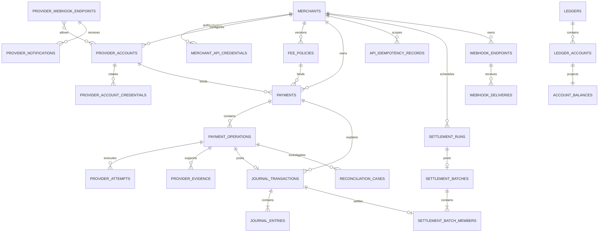

# PostgreSQL data model

Status: **Draft**  
Last updated: 2026-11-05

## Purpose

This document turns the scope, payment state machine, ledger contract, and event contracts into an implementable PostgreSQL model. It defines the authoritative rows, database constraints, idempotency boundaries, lock ownership, tenant isolation, retention, and migration order.

The schema resolves these MVP choices:

- USD is the only accepted currency.
- A payment has at most one successful authorization and one successful capture.
- A payment may have multiple successful refunds, concurrent or sequential, up to the captured amount. Unresolved refunds hold a reservation on the payment aggregate.
- The payment's provider and provider-account binding is immutable.
- The capture operation stores the exact fee-policy inputs and calculated fee used for the financial effect. Refund operations retain the same policy snapshot but compute their fee effect at confirmation.
- Platform ledger accounts on the capture/refund write path are striped into deterministic buckets.
- Settlement moves confirmed value from merchant clearing to merchant payable in immutable batches, entirely inside the ledger.
- Idempotency keys for mutating financial workflows do not expire. The complete replay result remains for 90 days; afterward a compact key, request hash, result identity, and uniqueness tombstone remain online for the lifetime of the merchant's financial records.
- Journal writes occur only through a protected PostgreSQL posting function. Application roles cannot insert, update, or delete journal rows directly.

## PostgreSQL conventions

### Schemas

| Schema | Owner | Contents |
| --- | --- | --- |
| `identity` | Identity module | Merchants and merchant API credentials |
| `providers` | Provider module | Provider accounts, deterministic routes, credential/webhook-secret versions, attempts, notifications, and evidence |
| `payments` | Payment module | Fee policies, payments, and payment operations |
| `api` | API module | Command idempotency records |
| `ledger` | Ledger module | Ledgers, accounts, journal transactions, entries, and synchronous balances |
| `settlement` | Settlement module | Settlement runs, posted batches, and immutable batch membership |
| `messaging` | Messaging module | Transactional outbox, consumer inbox, and dead-letter records |
| `webhooks` | Webhook module | Merchant webhook endpoints, deliveries, and attempts |
| `reconciliation` | Reconciliation module | Reconciliation cases and case activity |
| `audit` | Operator audit module | Append-only privileged-action records and approval evidence |

Tables use plural snake-case names. Foreign-key columns use the singular entity name followed by `_id`.

### IDs

Public domain entities use an application-generated identifier consisting of a lower-case prefix, `_`, and a 26-character upper-case Crockford ULID:

```text
mer_01J...   merchant
pay_01J...   payment
op_01J...    payment operation
ltx_01J...   ledger transaction
```

The PostgreSQL type is `text COLLATE "C"`. Every public-ID column has a table-specific regular-expression check such as:

```sql
CHECK (id ~ '^pay_[0-7][0-9A-HJKMNP-TV-Z]{25}$')
```

ULIDs improve locality and logs, but their lexical order is not a correctness or commit-order guarantee. Internal high-volume child rows MAY use `bigint GENERATED ALWAYS AS IDENTITY` when they are never accepted as public API identifiers.

Event envelope IDs are UUIDs, as defined by the event contract. `messaging.outbox_messages.envelope_id` and `messaging.inbox_messages.envelope_id` therefore use PostgreSQL `uuid`, not a prefixed ULID.

### Common types

- Timestamps use `timestamptz` and are stored in UTC.
- Monetary columns use `bigint` minor units. Wire formats encode them as unsigned decimal strings.
- A single command amount is between `1` and `1000000000000` minor units unless a more restrictive command guard applies.
- Confirmed totals use `bigint`, are nonnegative, and are checked for overflow before update.
- Currency uses `text NOT NULL CHECK (currency = 'USD')`.
- Canonical SHA-256 hashes use `bytea CHECK (octet_length(value) = 32)`.
- Provider references and idempotency keys are opaque `text`; code MUST NOT parse meaning from them.
- Status and kind columns use `text` plus `CHECK` constraints rather than PostgreSQL enums, allowing additive rolling migrations without an enum lock dependency.
- JSON columns use `jsonb` and, where an object is required, `CHECK (jsonb_typeof(column) = 'object')`.
- Every foreign-key column receives an explicit supporting index unless it is already the leading part of a primary or unique key.

Database-generated timestamps use `clock_timestamp()` or `statement_timestamp()` according to the repository contract. Application-provided timestamps cannot replace `recorded_at`, `created_at`, or `received_at` audit time.

## Relationship overview



## Identity and authentication

### `identity.merchants`

| Column | Type | Null? | Contract |
| --- | --- | --- | --- |
| `id` | `text COLLATE "C"` | No | PK; `mer_` ULID check |
| `display_name` | `text` | No | Length 1-200 |
| `status` | `text` | No | `ACTIVE`, `SUSPENDED`, or `CLOSED` |
| `default_currency` | `text` | No | Must be `USD` |
| `created_at` | `timestamptz` | No | Database default |
| `updated_at` | `timestamptz` | No | Guarded update |
| `closed_at` | `timestamptz` | Yes | Required only when `CLOSED` |

Constraints:

- `PRIMARY KEY (id)`.
- `CHECK ((status = 'CLOSED') = (closed_at IS NOT NULL))`.
- A merchant is suspended or closed, never deleted, while financial records reference it.

### `identity.merchant_api_credentials`

| Column | Type | Null? | Contract |
| --- | --- | --- | --- |
| `id` | `text COLLATE "C"` | No | PK; `mcr_` ULID check |
| `merchant_id` | `text COLLATE "C"` | No | FK to merchant |
| `key_prefix` | `text COLLATE "C"` | No | Non-secret lookup prefix |
| `credential_digest` | `bytea` | No | 32-byte keyed digest of the complete presented credential; raw key is never stored |
| `digest_version` | `smallint` | No | Positive key-derivation version |
| `scopes` | `text[]` | No | Nonempty allowlisted scopes |
| `status` | `text` | No | `ACTIVE` or `REVOKED` |
| `created_at` | `timestamptz` | No | Database default |
| `expires_at` | `timestamptz` | Yes | Optional authentication expiry |
| `revoked_at` | `timestamptz` | Yes | Required when revoked |
| `last_used_at` | `timestamptz` | Yes | Operational metadata only |

Constraints and indexes:

- `PRIMARY KEY (id)`.
- `UNIQUE (key_prefix)`; the authentication role uses this before tenant context exists.
- `UNIQUE (merchant_id, id)` supports tenant-safe composite foreign keys.
- `FOREIGN KEY (merchant_id) REFERENCES identity.merchants(id)` with no cascade.
- `CHECK (cardinality(scopes) > 0)` and a trigger rejects unknown scopes.
- `CHECK ((status = 'REVOKED') = (revoked_at IS NOT NULL))`.
- Authentication rejects an otherwise active credential when `expires_at <= clock_timestamp()`.
- `credential_digest`, merchant ownership, and `created_at` are immutable. Only `last_used_at`, status, and `revoked_at` may change.
- The digest is HMAC-SHA-256 over the complete ASCII credential `fl_test_<locator>_<secret>` using a versioned pepper held in Secret Manager. The locator selects the candidate row, but constant-time comparison of this full-credential digest authenticates it. This is not a password hash and the pepper is not stored in PostgreSQL.

## Provider configuration

### `providers.provider_accounts`

Each merchant receives a logical provider account row even if sandbox infrastructure ultimately shares credentials. This preserves tenant ownership and prevents one merchant's provider identifiers from entering another merchant's aggregate.

| Column | Type | Null? | Contract |
| --- | --- | --- | --- |
| `id` | `text COLLATE "C"` | No | PK; `pacc_` ULID check |
| `merchant_id` | `text COLLATE "C"` | No | Owning merchant |
| `provider_code` | `text` | No | Adapter code, such as `fake-provider` |
| `external_account_reference` | `text` | Yes | Opaque provider-side account reference |
| `environment` | `text` | No | `SANDBOX` or `SIMULATOR` in MVP |
| `status` | `text` | No | `ACTIVE`, `DISABLED`, or `REVOKED` |
| `created_at` | `timestamptz` | No | Database default |
| `updated_at` | `timestamptz` | No | Operational configuration time |

Constraints and indexes:

- `PRIMARY KEY (id)` and `UNIQUE (merchant_id, id)`.
- `UNIQUE (merchant_id, id, provider_code, environment)` supports an exact route-to-account foreign key.
- Composite FK to the owning merchant.
- `UNIQUE NULLS NOT DISTINCT (merchant_id, provider_code, external_account_reference, environment)`.
- `provider_code`, merchant ownership, environment, and external account reference are immutable. Credentials and behavioral configuration use versioned child tables; they are not replaced by mutating this identity.
- Operational lookup index: `(merchant_id, provider_code, status)`.

### `providers.merchant_routes`

Routing is configuration, never a nondeterministic scan of active accounts. One merchant may retain multiple provider accounts for history, but at most one active route exists for a provider code in one deployment environment and exactly zero or one active route is the merchant default.

| Column | Type | Null? | Contract |
| --- | --- | --- | --- |
| `merchant_id` | `text COLLATE "C"` | No | Route owner |
| `provider_code` | `text` | No | Explicit API selector |
| `environment` | `text` | No | `SANDBOX` or `SIMULATOR` |
| `provider_account_id` | `text COLLATE "C"` | No | Selected logical account |
| `is_default` | `boolean` | No | Used when the create request omits `provider` |
| `status` | `text` | No | `ACTIVE` or `DISABLED` |
| `created_at` | `timestamptz` | No | Database time |
| `updated_at` | `timestamptz` | No | Guarded configuration time |

`PRIMARY KEY (merchant_id, provider_code, environment)` and `UNIQUE (merchant_id, provider_account_id)` prevent ambiguous explicit routes. A partial unique index on `(merchant_id, environment) WHERE status='ACTIVE' AND is_default` permits one default. The composite FK `(merchant_id, provider_account_id, provider_code, environment)` references the exact provider-account identity. The protected routing query selects one route under the merchant and deployment environment, using `provider_code` when supplied or `is_default` when omitted, then requires the route and account to be active and reads the account's one current immutable configuration version in the same payment-creation transaction. Missing/disabled selection maps to `PROVIDER_ROUTE_UNAVAILABLE`; it never falls back to another account.

### `providers.provider_account_versions`

Behavioral adapter configuration is immutable once referenced by a payment.

| Column | Type | Null? | Contract |
| --- | --- | --- | --- |
| `provider_account_id` | `text COLLATE "C"` | No | Provider account |
| `version` | `integer` | No | Positive monotonic version |
| `configuration` | `jsonb` | No | Non-secret schema-validated adapter configuration |
| `capabilities_hash` | `bytea` | No | Hash of the declared provider capability set |
| `created_at` | `timestamptz` | No | Database time |
| `superseded_at` | `timestamptz` | Yes | Null for routing-current version |

`PRIMARY KEY (provider_account_id, version)`. The configuration and capability hash are immutable; one partial unique index permits one nonsuperseded version. Secret rotation remains separate and may apply to existing payments without changing their financial semantics.

### `providers.provider_account_credentials`

| Column | Type | Null? | Contract |
| --- | --- | --- | --- |
| `id` | `text COLLATE "C"` | No | PK; `pac_` ULID check |
| `merchant_id` | `text COLLATE "C"` | No | Tenant copy for composite FK |
| `provider_account_id` | `text COLLATE "C"` | No | Provider account |
| `version` | `integer` | No | Positive monotonic version per account |
| `secret_reference` | `text` | No | Secret Manager resource and immutable version, never the secret |
| `status` | `text` | No | `ACTIVE`, `RETIRED`, or `REVOKED` |
| `created_at` | `timestamptz` | No | Database default |
| `retired_at` | `timestamptz` | Yes | End of active use |

Constraints and indexes:

- `UNIQUE (provider_account_id, version)`.
- Composite FK `(merchant_id, provider_account_id)` to provider accounts.
- One current credential: unique partial index on `(provider_account_id) WHERE status = 'ACTIVE'`.
- `secret_reference` and version are immutable. Revocation changes status; rows are never overwritten or deleted.

### `providers.webhook_endpoints`

A webhook endpoint is a provider ingress/signature configuration. It is separate from a merchant's logical provider account because a provider may serve many isolated merchant bindings behind one external account and signing secret. Keeping the two separate means tenant identity is never derived from the ingress route or the payload.

| Column | Type | Null? | Contract |
| --- | --- | --- | --- |
| `id` | `text COLLATE "C"` | No | PK; `pwe_` ULID check |
| `provider_code` | `text` | No | Adapter registry key |
| `endpoint_key` | `text COLLATE "C"` | No | Random 26-character Crockford Base32 route locator |
| `external_account_reference` | `text` | Yes | Signed provider account context, when applicable |
| `status` | `text` | No | `ACTIVE` or `REVOKED` |
| `created_at` | `timestamptz` | No | Database time |
| `retired_at` | `timestamptz` | Yes | Required when revoked |

Constraints:

- `PRIMARY KEY (id)` and `UNIQUE (provider_code, endpoint_key)`.
- `endpoint_key` matches `^[0-7][0-9A-HJKMNP-TV-Z]{25}$`, carries 128 random bits, and is a locator rather than an authentication secret.
- Provider, endpoint key, and external account reference are immutable. The endpoint row is the stable deduplication/route identity across signing-secret rotation; revocation is one-way and rows remain for evidence verification.

### `providers.webhook_endpoint_secret_versions`

Secret rotation never changes the logical endpoint ID or event-deduplication scope.

| Column | Type | Null? | Contract |
| --- | --- | --- | --- |
| `webhook_endpoint_id` | `text COLLATE "C"` | No | Stable endpoint |
| `version` | `integer` | No | Positive monotonic secret version |
| `signing_secret_reference` | `text` | No | Secret Manager immutable version reference |
| `verifier_version` | `text` | No | Signature/timestamp verifier configuration version |
| `status` | `text` | No | `ACTIVE`, `OVERLAP`, or `RETIRED` |
| `accepted_from` | `timestamptz` | No | Inclusive verification window |
| `accepted_until` | `timestamptz` | Yes | Required for bounded overlap/retired versions |
| `created_at` | `timestamptz` | No | Database time |

`PRIMARY KEY (webhook_endpoint_id, version)`. One partial unique index permits one `ACTIVE` version per endpoint. Rotation inserts the new active version and moves the prior one to `OVERLAP` with a bounded `accepted_until`; no new endpoint/route key is created. Secret references and verification windows are immutable after insertion except the one guarded ACTIVE-to-OVERLAP/RETIRED transition and setting its end time. The receiver tries only the bounded active/overlap set and stores the version that verified the request.

### `providers.webhook_endpoint_accounts`

| Column | Type | Null? | Contract |
| --- | --- | --- | --- |
| `webhook_endpoint_id` | `text COLLATE "C"` | No | FK to webhook endpoint |
| `provider_account_id` | `text COLLATE "C"` | No | Logical provider account allowed on the endpoint |
| `created_at` | `timestamptz` | No | Allowlist time |
| `retired_at` | `timestamptz` | Yes | One-way removal from future matching |

`PRIMARY KEY (webhook_endpoint_id, provider_account_id)`. Correlation accepts a verified notification for an operation only when this mapping is active (or was active at the notification's provider time under an audited rotation rule). This supports both one endpoint per logical account and a single shared endpoint serving an allowlisted set, without ever allowing payload-selected tenant identity.

## Versioned fee policy

### `payments.fee_policies`

Fee-policy rows are immutable versions. Editing a fee creates a new row; existing payments and operations continue to reference the old version.

| Column | Type | Null? | Contract |
| --- | --- | --- | --- |
| `id` | `text COLLATE "C"` | No | PK; `fee_` ULID check |
| `merchant_id` | `text COLLATE "C"` | No | Owning merchant |
| `version` | `integer` | No | Positive merchant policy version |
| `currency` | `text` | No | `USD` |
| `basis_points` | `integer` | No | `0..10000` |
| `fixed_amount_minor` | `bigint` | No | `0..1000000000000` |
| `minimum_capture_amount_minor` | `bigint` | No | Smallest capture this policy can price; at least `fixed_amount_minor`, at least 1, and large enough that the fee charged at it does not exceed it (see `fee_policies_fee_within_minimum`) |
| `capture_rounding_mode` | `text` | No | `HALF_UP` for MVP; applies to the capture percentage component only |
| `refund_fee_mode` | `text` | No | `PROPORTIONAL` for the MVP |
| `effective_from` | `timestamptz` | No | Inclusive |
| `superseded_at` | `timestamptz` | Yes | Null for current policy |
| `created_at` | `timestamptz` | No | Database default |

Constraints and indexes:

- `PRIMARY KEY (id)`.
- `UNIQUE (merchant_id, version)` and `UNIQUE (merchant_id, id, version)`.
- One current policy per merchant/currency: unique partial index on `(merchant_id, currency) WHERE superseded_at IS NULL`.
- `CHECK (basis_points BETWEEN 0 AND 10000)`.
- `CHECK (fixed_amount_minor BETWEEN 0 AND 1000000000000)`.
- `CHECK (minimum_capture_amount_minor >= GREATEST(fixed_amount_minor, 1))`.
- `CONSTRAINT fee_policies_fee_within_minimum CHECK ((minimum_capture_amount_minor * basis_points + 5000) / 10000 + fixed_amount_minor <= minimum_capture_amount_minor)`. This is the structural guarantee that an accepted capture can always be priced: a policy must declare a minimum high enough to cover the fee it charges at that minimum. `bigint` division truncates, which is the intended floor for these non-negative operands, and the intermediate product is at most `10^16`, inside `bigint` range. The preceding check does not imply this one: `basis_points = 5000`, `fixed_amount_minor = 30`, minimum 30 admits a capture of 40 whose fee is 50.
- `CHECK (capture_rounding_mode = 'HALF_UP')`. The column name states its scope: it governs the capture percentage component only. Refund reversal is defined by the cumulative floor rule below and does not consult it.
- `CHECK (refund_fee_mode = 'PROPORTIONAL')`. Refund fee uses the exact cumulative contract `targetFeeReversed(R)=floor(F*R/G)` and `incremental=target(R1)-target(R0)` from the ledger contract, evaluated at refund **confirmation** from confirmed cumulative refunds. Fractional-minor-unit residual is assigned to later confirmations, and a full cumulative refund reverses the full captured fee exactly regardless of confirmation order.
- The entire row is immutable except setting `superseded_at` once. A trigger rejects clearing or changing it afterward.

The fee formula is exactly `percentage_fee=floor((gross*basis_points+5000)/10000)` and `capture_fee=percentage_fee+fixed_amount_minor`, using checked wide-integer arithmetic as defined by the ledger contract.

The guarded acceptance function rejects a capture amount below `minimum_capture_amount_minor` as `422 CAPTURE_BELOW_MINIMUM` before inserting an operation. `fee_policies_fee_within_minimum` proves the fee charged at the policy minimum does not exceed that minimum, and `capture_fee - gross` is non-increasing over the whole `basis_points <= 10000` domain, so `capture_fee <= gross` holds for every capture at or above the minimum. The function still asserts `0 <= capture_fee <= gross` as a protected invariant; a violation there is an internal invariant breach rather than a client error, and the fee is never silently capped.

The capture operation snapshots the inputs, the exact fee result, and the capture gross. Reconciliation never recalculates from the currently active fee policy.

## Payment aggregate

### `payments.payments`

| Column | Type | Null? | Contract |
| --- | --- | --- | --- |
| `id` | `text COLLATE "C"` | No | PK; `pay_` ULID check |
| `merchant_id` | `text COLLATE "C"` | No | Tenant owner |
| `merchant_reference` | `text` | Yes | Optional merchant-visible reference |
| `currency` | `text` | No | `USD` |
| `payment_method_reference_ciphertext` | `bytea` | No | AEAD-encrypted opaque sandbox-provider token |
| `payment_method_key_version` | `text` | No | Immutable KMS/envelope-encryption key version |
| `payment_method_reference_hash` | `bytea` | No | Keyed 32-byte lookup/audit digest; never a reversible token |
| `provider_account_id` | `text COLLATE "C"` | No | Immutable provider binding |
| `provider_account_version` | `integer` | No | Immutable adapter/account configuration version selected by routing |
| `provider_payment_id` | `text` | Yes | Opaque append-once provider payment reference |
| `provider_authorization_id` | `text` | Yes | Opaque append-once successful authorization reference |
| `provider_capture_id` | `text` | Yes | Opaque append-once successful capture reference |
| `fee_policy_id` | `text COLLATE "C"` | No | Immutable policy binding |
| `fee_policy_version` | `integer` | No | Denormalized, constrained version |
| `requested_amount_minor` | `bigint` | No | Positive, at most platform maximum |
| `authorized_amount_minor` | `bigint` | No | Default 0 |
| `captured_amount_minor` | `bigint` | No | Default 0 |
| `refunded_amount_minor` | `bigint` | No | Default 0; confirmed refunds only |
| `voided_amount_minor` | `bigint` | No | Default 0 |
| `reserved_refund_amount_minor` | `bigint` | No | Default 0; sum of unresolved refund operation amounts |
| `unresolved_refund_count` | `integer` | No | Default 0; count of unresolved refund operations |
| `authorization_outcome` | `text` | No | Canonical outcome from state-machine contract |
| `active_exclusive_operation_id` | `text COLLATE "C"` | Yes | Current unresolved `AUTHORIZE`, `CAPTURE`, or `CANCEL` operation |
| `version` | `bigint` | No | Starts at 1, positive |
| `created_by_credential_id` | `text COLLATE "C"` | Yes | Auditing credential |
| `created_at` | `timestamptz` | No | Database default |
| `updated_at` | `timestamptz` | No | Last aggregate change |

Keys and tenant-safe foreign keys:

- `PRIMARY KEY (id)`.
- `UNIQUE (merchant_id, id)`.
- `UNIQUE (merchant_id, id, provider_account_id, provider_account_version)` is the parent key used to prove that every operation inherits this payment's immutable provider/configuration binding.
- Optional partial unique index on `(merchant_id, merchant_reference) WHERE merchant_reference IS NOT NULL`.
- Composite FK `(merchant_id, provider_account_id)` to provider accounts.
- Composite FK `(provider_account_id, provider_account_version)` to immutable provider account versions.
- Composite FK `(merchant_id, fee_policy_id, fee_policy_version)` to fee policies.
- Composite FK `(merchant_id, created_by_credential_id)` to API credentials when nonnull.
- The active-exclusive-operation composite FK is added after operations exist: `(merchant_id, id, active_exclusive_operation_id)` references `(merchant_id, payment_id, id)` and is `DEFERRABLE INITIALLY IMMEDIATE`.
- A deferred consistency trigger checks at commit that:
  - `active_exclusive_operation_id` is null exactly when no unresolved `AUTHORIZE`, `CAPTURE`, or `CANCEL` operation exists, and otherwise identifies the one operation selected by the unresolved-exclusive partial unique index;
  - `reserved_refund_amount_minor` equals the sum of `amount_minor` over this payment's refund operations whose status is `REQUESTED`, `PROCESSING`, `UNKNOWN`, or `REQUIRES_REVIEW`;
  - `unresolved_refund_count` equals the count of those rows.
  The reservation fields are a maintained aggregate, so the trigger is what makes them trustworthy. A drift between the scalar and the operation rows is a commit-blocking invariant error, not a repairable inconsistency.

Checks:

```text
requested_amount_minor BETWEEN 1 AND 1000000000000
authorized_amount_minor >= 0
captured_amount_minor >= 0
refunded_amount_minor >= 0
voided_amount_minor >= 0
reserved_refund_amount_minor >= 0
unresolved_refund_count >= 0

authorized_amount_minor <= requested_amount_minor
captured_amount_minor <= authorized_amount_minor
refunded_amount_minor <= captured_amount_minor
voided_amount_minor <= authorized_amount_minor - captured_amount_minor

refunded_amount_minor + reserved_refund_amount_minor <= captured_amount_minor
(reserved_refund_amount_minor = 0) = (unresolved_refund_count = 0)

version >= 1
```

`refunded + reserved <= captured` is a row check, so the over-refund guarantee survives even a defect in the acceptance function. The guard in `payments.accept_operation` evaluates the same expression under the payment row lock to produce a clean `409` rather than a constraint violation.

Additional state checks enforce:

- `NOT_REQUESTED` or `DECLINED` implies all confirmed monetary totals are zero.
- `CANCELED` or `EXPIRED` implies captured and refunded are zero and voided equals authorized.
- A positive captured amount implies `captured + voided = authorized`.

`provider_account_id`, `provider_account_version`, encrypted payment-method binding, currency, requested amount, fee-policy binding, merchant ownership, and creation fields are immutable. `provider_account_version` is the single version of the adapter/account behavioral configuration selected by routing; no separate provider-routing version is stored. Provider payment, authorization, and capture references may transition from null to a value exactly once after verified evidence and can never be changed or cleared. Only the guarded payment transition repository may update confirmed totals, refund reservation fields, append-once provider references, authorization outcome, the active exclusive pointer, version, and `updated_at`.

The refund reservation fields are the only aggregate columns a nonterminal operation may change. Everything else on this row changes solely through a confirmed provider outcome or a verified expiry.

Every committed payment-version increment is paired atomically with exactly one version-advancing payment lifecycle outbox event, and each such event carries the resulting version. This includes authorization expiry and each newly deduplicated discrepancy. A discrepancy advances `payments.version` even though totals, `authorization_outcome`, active operation, terminal operation, and journal remain unchanged; reconsuming the same evidence cannot advance it again.

The payment-method reference is encrypted before insertion with authenticated envelope encryption and associated data containing merchant, payment, and provider-account IDs. Only the authorization-worker role may request decryption. Plaintext exists only while constructing an `AUTHORIZE` provider call and is excluded from responses, outbox messages, attempt/evidence rows, logs, traces, and errors.

Indexes:

- `(merchant_id, created_at DESC, id)` for merchant payment history.
- `(merchant_id, authorization_outcome, updated_at DESC)` for operator queries.
- `(active_exclusive_operation_id) WHERE active_exclusive_operation_id IS NOT NULL`.
- `(merchant_id, updated_at DESC, id) WHERE unresolved_refund_count > 0` for operator and sweeper queries over payments with refunds in flight.

### `payments.payment_operations`

| Column | Type | Null? | Contract |
| --- | --- | --- | --- |
| `id` | `text COLLATE "C"` | No | PK; `op_` ULID check |
| `merchant_id` | `text COLLATE "C"` | No | Tenant copy |
| `payment_id` | `text COLLATE "C"` | No | Owning payment |
| `type` | `text` | No | `AUTHORIZE`, `CAPTURE`, `CANCEL`, or `REFUND` |
| `amount_minor` | `bigint` | No | Positive USD amount |
| `currency` | `text` | No | `USD` |
| `status` | `text` | No | State-machine operation status |
| `provider_account_id` | `text COLLATE "C"` | No | Must equal payment binding |
| `provider_account_version` | `integer` | No | Must equal payment binding |
| `provider_idempotency_key` | `text COLLATE "C"` | No | Stable for operation lifetime |
| `provider_operation_id` | `text` | Yes | Opaque returned provider reference |
| `capture_operation_id` | `text COLLATE "C"` | Yes | Successful capture refunded by this operation |
| `fee_policy_id` | `text COLLATE "C"` | Yes | Snapshot source for capture/refund |
| `fee_policy_version` | `integer` | Yes | Snapshot source version |
| `fee_basis_points` | `integer` | Yes | Exact snapshot input |
| `fee_fixed_amount_minor` | `bigint` | Yes | Exact snapshot input |
| `fee_capture_rounding_mode` | `text` | Yes | Exact snapshot input; governs the capture percentage component only |
| `fee_refund_mode` | `text` | Yes | Exact snapshot input |
| `fee_effect_type` | `text` | No | `NONE`, `CHARGE`, or `REFUND` |
| `fee_effect_amount_minor` | `bigint` | Yes | Capture: exact fee snapshotted at acceptance. Refund: null until the terminal transition computes it. Authorize/cancel: always null |
| `result_code` | `text` | Yes | Normalized, non-sensitive code |
| `resolution_source` | `text` | Yes | `API_RESPONSE`, `PROVIDER_WEBHOOK`, or `RECONCILIATION` |
| `resolution_evidence_id` | `text COLLATE "C"` | Yes | Verified evidence consumed by terminal transition |
| `processing_started_at` | `timestamptz` | Yes | First provider-execution claim |
| `lease_token` | `uuid` | Yes | Current worker lease identity |
| `lease_expires_at` | `timestamptz` | Yes | Stale-processing detection |
| `not_before` | `timestamptz` | Yes | Durable same-operation execution deferral; null means ready/already enqueued |
| `version` | `bigint` | No | Positive transition version |
| `created_at` | `timestamptz` | No | Acceptance time |
| `updated_at` | `timestamptz` | No | Last operation transition |
| `resolved_at` | `timestamptz` | Yes | Required only for terminal status |

Keys and constraints:

- `PRIMARY KEY (id)`.
- `UNIQUE (merchant_id, id)` is the tenant-safe parent key for evidence, notifications, attempts, and reconciliation children.
- `UNIQUE (merchant_id, payment_id, id)` supports the active-operation FK.
- `UNIQUE (merchant_id, id, provider_account_id, provider_idempotency_key)` supports an exact composite FK from provider attempts.
- Composite FK `(merchant_id, payment_id, provider_account_id, provider_account_version)` to an equivalent unique key on payments. This is the database boundary that prevents an operation from changing providers or behavioral configuration.
- `UNIQUE (provider_account_id, provider_idempotency_key)`.
- Composite fee-policy FK when a snapshot is present.
- `CHECK (amount_minor BETWEEN 1 AND 1000000000000)`.
- Terminal statuses `SUCCEEDED`, `REJECTED`, and `FAILED` require `resolved_at`; nonterminal statuses require it to be null.
- Terminal statuses require a tenant/operation-safe `resolution_evidence_id` and matching `resolution_source`. `SUCCEEDED` requires a nonnull provider operation ID and null result code; `REJECTED`/`FAILED` require a bounded result code. The evidence FK is added after the evidence table is created.
- After evidence exists, add the deferrable composite FK `(merchant_id, id, resolution_evidence_id) REFERENCES providers.provider_evidence(merchant_id, operation_id, id)`. This makes it impossible to resolve an operation from evidence belonging to another tenant or operation while allowing the circular evidence-to-operation relationship to be created in migration order.
- Capture and refund rows require a complete fee-input snapshot. Refund requires a tenant/payment-safe FK to the one successful `CAPTURE` operation; every other operation type requires `capture_operation_id` null. Authorize and cancel rows require null fee-policy snapshot columns, `fee_effect_type = 'NONE'`, and null `fee_effect_amount_minor`.
- Capture requires `fee_effect_type = 'CHARGE'` and nonnull `0 <= fee_effect_amount_minor <= amount_minor` from acceptance onward.
- Refund requires `fee_effect_type = 'REFUND'` and `fee_effect_amount_minor IS NULL` while the status is nonterminal. The terminal transition sets it exactly once; `SUCCEEDED` requires a nonnull value and `REJECTED`/`FAILED` require it to remain null, because a refund that never applied reverses no fee.
- On insert, the guarded operation function recomputes the exact capture fee from the referenced immutable fee-policy row, verifies every snapshotted input and result, and rejects a capture below `minimum_capture_amount_minor` before any operation or outbox row exists. A refund copies the capture's fee inputs but stores **no** fee effect at acceptance: under concurrent refunds two acceptances would compute the same cumulative base and collectively over-reverse the fee, and a snapshot taken before an earlier refund failed would be stale. The confirming transaction computes `floor(F*R1/G) - floor(F*R0/G)` from confirmed cumulative refunds while holding the payment lock, reading `F` and `G` through `capture_operation_id`. Snapshot input columns are immutable after insert; `fee_effect_amount_minor` is immutable after the terminal transition sets it. See [ADR-0008](adr/0008-fee-recognized-at-capture.md).
- Terminal operation states are one-way. Corroborating or contradictory late results append provider evidence and never change one terminal status to another.
- `not_before` is permitted only while status is `REQUESTED`. A nonnull value means no execution command is currently claimable; a ready/enqueued `REQUESTED` row has null `not_before`. Setting a future value and clearing it are protected transitions, never ad hoc scheduler updates.
- Operation `version` starts at 1. It increments exactly once per committed protected operation-row mutation: `REQUESTED -> PROCESSING` claim and lease assignment, pre-dispatch lease reassignment, safe deferral or `PROCESSING -> REQUESTED` retry scheduling, transition to `UNKNOWN`/`REQUIRES_REVIEW`, and a terminal transition with its result/reference/resolution fields. All columns changed by one transition share one new version. Appending an attempt/evidence/case activity without changing the operation row, duplicate/corroborating evidence, authorization expiry, and discrepancy recording against a terminal operation do not increment it. Payment aggregate version follows the separate lifecycle-event rules in the state-machine contract.

Concurrency and cardinality indexes:

```sql
-- Exclusive classes only. REFUND is deliberately absent: concurrent unresolved
-- refunds are permitted and are bounded by the reservation guard on the payment
-- row, not by a uniqueness index.
CREATE UNIQUE INDEX payment_operations_one_active_exclusive
ON payments.payment_operations (payment_id)
WHERE type IN ('AUTHORIZE', 'CAPTURE', 'CANCEL')
  AND status IN ('REQUESTED', 'PROCESSING', 'UNKNOWN', 'REQUIRES_REVIEW');

CREATE UNIQUE INDEX payment_operations_one_successful_authorization
ON payments.payment_operations (payment_id)
WHERE type = 'AUTHORIZE' AND status = 'SUCCEEDED';

CREATE UNIQUE INDEX payment_operations_one_successful_capture
ON payments.payment_operations (payment_id)
WHERE type = 'CAPTURE' AND status = 'SUCCEEDED';

CREATE UNIQUE INDEX payment_operations_one_successful_cancel
ON payments.payment_operations (payment_id)
WHERE type = 'CANCEL' AND status = 'SUCCEEDED';
```

There is intentionally no unique index limiting successful or unresolved refunds. Multiple refund operations may be unresolved and may succeed. The locked payment aggregate enforces `refunded_amount_minor + reserved_refund_amount_minor <= captured_amount_minor`, backed by the row check on `payments.payments`.

This is a deliberate placement of the guarantee. An index that permitted only one unresolved refund would make the over-refund property a uniqueness artifact and would leave the monetary guard unreachable under concurrency. See [ADR-0003](adr/0003-exclusive-operations-and-reserved-refunds.md).

Operational indexes:

- `(merchant_id, payment_id, created_at, id)` for operation history.
- `(not_before, created_at, id) WHERE status = 'REQUESTED' AND not_before IS NOT NULL` for the due-work scheduler, plus `(status, lease_expires_at) WHERE status IN ('PROCESSING', 'UNKNOWN', 'REQUIRES_REVIEW')` for workers and stale sweeps.
- `(provider_account_id, provider_operation_id) WHERE provider_operation_id IS NOT NULL` for evidence correlation; this is not universally unique because some providers reuse a payment object across actions.

### Protected payment transition functions

Runtime roles have no direct `INSERT`, `UPDATE`, `DELETE`, or `TRUNCATE` privilege on `payments.payments` or `payments.payment_operations`. Mutations occur through fixed-`search_path`, `SECURITY DEFINER` functions owned by a non-login payment-function role:

- `payments.create_payment(...)` derives the authenticated merchant from transaction context and atomically inserts payment, idempotency result, and creation event.
- `payments.accept_operation(...)` claims the API idempotency key, locks the payment, evaluates the exact command guard and three-authorization-attempt limit, inserts one operation, and writes both outbox envelopes. For an exclusive command it requires no unresolved exclusive operation and no unresolved refund, then sets `active_exclusive_operation_id`. For a refund it requires no unresolved exclusive operation and `refunded + reserved + amount <= captured`, then adds the amount to `reserved_refund_amount_minor` and increments `unresolved_refund_count`. For a capture it recomputes and snapshots the exact fee and rejects an amount below the policy minimum; for a refund it copies the capture's fee inputs and stores no fee effect. Payment version increments in every accepted case.
- `payments.claim_operation(...)` accepts only `REQUESTED` with `not_before IS NULL`, performs `REQUESTED -> PROCESSING`, creates the `RESERVED` provider attempt, establishes the single lease owner, and increments operation version.
- `payments.mark_dispatch(...)` compares the operation and attempt lease token, changes the attempt to `DISPATCH_MARKED`, and commits immediately before network I/O.
- `payments.defer_operation(...)` defers a still-`REQUESTED`, never-dispatched operation for a local limiter/circuit decision by setting bounded `not_before` and incrementing operation version; it creates no attempt and does not change payment version.
- `payments.requeue_stale_pre_dispatch(operation_id, expected_lease_token)` locks the operation/current attempt, requires an expired lease with attempt state `RESERVED` and null `dispatch_marked_at`, marks that attempt `ABANDONED`, performs `PROCESSING -> REQUESTED`, clears lease fields, increments operation version, and inserts a fresh execution-command outbox row in the same transaction. Payment version and confirmed state do not change. If a dispatch mark exists, the function refuses and the stale-post-dispatch path must use `mark_unknown`.
- `payments.schedule_same_operation_retry(evidence_id, retry_not_before)` accepts only unapplied `RETRYABLE_NO_EFFECT` evidence with typed no-effect proof from the current attempt, completes that attempt, performs `PROCESSING -> REQUESTED`, stores bounded `not_before`, clears the lease, and increments operation version. It preserves active operation, payment version, confirmed fields, and provider key.
- `payments.enqueue_due_operations(batch_size)` claims due `REQUESTED` rows with `FOR UPDATE SKIP LOCKED`; for each row it clears `not_before`, increments operation version, and inserts a fresh `payment.operation.execute.v1` outbox envelope for the same operation in the same transaction. A crash cannot clear the schedule without publishing durable work.
- `payments.mark_unknown(...)` accepts only a possibly dispatched nonterminal operation, clears its execution lease, increments the payment version, retains the exclusive pointer or the refund reservation according to the operation's class, and atomically creates the one durable open reconciliation case plus its initial activity before writing reconciliation event/command envelopes. Adapter ambiguity creates `AMBIGUOUS_OUTCOME`; a stale post-dispatch lease creates `STALE_PROCESSING`. The case insert uses the unresolved-case uniqueness boundary and deterministic operation/reason data, so replay returns the existing case instead of creating parallel work.
- `payments.require_operation_review(case_id, expected_case_version)` locks payment, operation, and reconciliation case in canonical order, requires an `UNKNOWN` operation whose automated policy is exhausted, performs `UNKNOWN -> REQUIRES_REVIEW`, increments operation and payment versions, retains the exclusive pointer or refund reservation according to class, updates the case, and writes `payment.operation.review.required.v1` atomically. It cannot accept operator-supplied financial outcome data.
- `payments.apply_provider_evidence(evidence_id)` locks payment then operation and then any unresolved case for that operation, verifies that an unapplied evidence row matches merchant, provider account, operation type, amount, currency, and immutable references, and performs the only success/rejection/failure transition. If the operation was `UNKNOWN` or `REQUIRES_REVIEW`, the same transaction marks its ambiguity/stale case `RESOLVED`, records the evidence/resolution activity, clears its lease/schedule, and only then releases the operation's hold on the aggregate; no terminal operation can leave claimable reconciliation work behind.

  Releasing the hold is class-specific. An exclusive operation clears `active_exclusive_operation_id`. A refund subtracts its amount from `reserved_refund_amount_minor` and decrements `unresolved_refund_count`; on success it simultaneously adds that amount to `refunded_amount_minor`, so the sum `refunded + reserved` never rises during the transition and the row check cannot be transiently violated.

  For a refund success the function computes the incremental fee reversal in this transaction from `refunded_amount_minor` before the update and the capture's `F` and `G`, writes it to `fee_effect_amount_minor`, and passes it to the ledger function. A refund rejection or failure leaves `fee_effect_amount_minor` null.

  An authorization success is rejected unless its evidence has nonnull provider payment, operation, and authorization references; it also creates the one durable `AUTHORIZATION_EXPIRY` case, scheduled at the provider-declared expiry when present or the immutable provider-account policy threshold otherwise. Capture/refund success invokes the protected ledger function inside the same transaction. Successful capture or cancellation dismisses any open expiry case atomically.
- `payments.record_authorization_expiry(evidence_id)` accepts only newly deduplicated, explicit `AUTHORIZATION_EXPIRED` webhook/reconciliation evidence. It locks the payment, requires `AUTHORIZED`, zero captured/refunded/voided totals, a null `active_exclusive_operation_id`, `unresolved_refund_count = 0`, and exact provider-account/payment/authorization-reference matches; then it sets `EXPIRED`, sets voided equal to authorized, increments payment version, closes the expiry case, marks the evidence applied, and writes `payment.authorization.expired.v1`. It never mutates the terminal authorization operation/version. If capture or cancellation already succeeded, the case is dismissed without a payment mutation; if any operation is unresolved, expiry remains scheduled.
- `payments.record_discrepancy(evidence_id)` consumes each newly deduplicated contradiction once, creates or updates its reconciliation case, increments payment version, and writes one `payment.discrepancy.detected.v1`, while preserving confirmed fields, authorization outcome, subject operation/version, and ledger. Reapplying the same evidence is a no-op.

Each function validates the invoker role and authenticated merchant or service identity.

Refund acceptance locks the payment, identifies the one successful capture, stores its ID on the refund operation, copies the capture's fee inputs, and proves `refunded + reserved + amount <= captured`. It does not compute or store a fee reversal. Refund confirmation computes the incremental reversal and proves `fee_reversed + incremental <= captured_fee`, which is implied by the cumulative formula but asserted anyway. Direct repository SQL cannot bypass either check.

A deferrable constraint trigger is installed on **both** payment and payment-operation insert/update. At commit it proves:

- `payments.active_exclusive_operation_id` identifies exactly the one unresolved `AUTHORIZE`/`CAPTURE`/`CANCEL` operation, or is null when none exists.
- `reserved_refund_amount_minor` equals the sum of `amount_minor` over this payment's unresolved refund operations, and `unresolved_refund_count` equals their count.
- Terminal transitions are one-way.
- Confirmed totals and outcomes agree with the successful-operation cardinality indexes.

Disabling this trigger is restricted to the audited migration owner.

## API idempotency

### `api.idempotency_records`

| Column | Type | Null? | Contract |
| --- | --- | --- | --- |
| `merchant_id` | `text COLLATE "C"` | No | Tenant scope |
| `command_type` | `text` | No | Stable command name, not raw URL |
| `idempotency_key` | `text COLLATE "C"` | No | Merchant-supplied key, 16-128 allowed characters |
| `request_hash` | `bytea` | No | Canonical SHA-256 request hash |
| `resource_type` | `text` | No | `PAYMENT` or `PAYMENT_OPERATION` |
| `resource_id` | `text COLLATE "C"` | No | Created/existing result identity |
| `http_status` | `smallint` | No | Replay status, normally 201 or 202 |
| `response_body` | `jsonb` | Yes | Sanitized exact replay body during 90-day replay window |
| `response_headers` | `jsonb` | Yes | Safe `Location`, content type, ETag, and correlation header |
| `response_hash` | `bytea` | No | SHA-256 of canonical response |
| `correlation_id` | `text COLLATE "C"` | No | Original workflow correlation ID returned on replay |
| `credential_id` | `text COLLATE "C"` | No | Credential that created the record |
| `committed_at` | `timestamptz` | No | Original command commit time |
| `replay_expires_at` | `timestamptz` | No | Exactly 90 days after commit |
| `tombstoned_at` | `timestamptz` | Yes | One-way replay-body expiry time |

Constraints:

- `PRIMARY KEY (merchant_id, command_type, idempotency_key)` is the exact API command idempotency boundary.
- `command_type` is checked to `CREATE_PAYMENT`, `AUTHORIZE`, `CAPTURE`, `CANCEL`, or `REFUND`.
- Merchant and credential use composite tenant-safe foreign keys.
- A constraint trigger validates the polymorphic result reference: `PAYMENT` must identify a same-merchant payment and is allowed only for `CREATE_PAYMENT`; `PAYMENT_OPERATION` must identify a same-merchant operation of the command's exact type.
- Request and response hashes are 32 bytes.
- Key format check: 16-128 case-sensitive characters matching `[A-Za-z0-9._:-]+`.
- Before `replay_expires_at`, response body and safe headers are nonnull and an exact retry replays them. A one-way tombstoning transition at or after expiry clears those two fields and sets `tombstoned_at`; the key, request/response hashes, resource identity, original status, correlation ID, and commit time remain online forever.
- The record is inserted in the same transaction as payment/operation creation and its outbox rows. A committed `IN_PROGRESS` state is unnecessary.
- Claiming uses `INSERT ... ON CONFLICT DO NOTHING`, not an unhandled unique violation. A nonowner locks/reads the committed row after the current owner resolves, compares the request hash, and replays or conflicts; a bounded database lock timeout maps to `IDEMPOTENCY_REQUEST_IN_PROGRESS` without executing domain logic.
- Reusing the primary key with the same request hash returns the recorded result. A different hash returns `409 Conflict`.
- After tombstoning, any reuse returns `409 IDEMPOTENCY_KEY_EXPIRED` and a safe resource location; it never executes again and does not claim to replay the original representation.
- All financial identity fields are immutable.

Indexes: `(merchant_id, committed_at DESC)` supports audit queries, and `(replay_expires_at) WHERE tombstoned_at IS NULL` supports bounded tombstoning. There is no cleanup index because uniqueness tombstones are lifetime records.

## Provider execution and evidence

### `providers.provider_attempts`

One row records one actual network interaction. Retrying a transport call creates another attempt but reuses the operation's provider idempotency key.

| Column | Type | Null? | Contract |
| --- | --- | --- | --- |
| `id` | `text COLLATE "C"` | No | PK; `pat_` ULID check |
| `merchant_id` | `text COLLATE "C"` | No | Tenant copy |
| `operation_id` | `text COLLATE "C"` | No | Payment operation |
| `provider_account_id` | `text COLLATE "C"` | No | Bound provider account |
| `credential_version` | `integer` | No | Secret version used |
| `attempt_number` | `integer` | No | Starts at 1 per operation |
| `provider_idempotency_key` | `text COLLATE "C"` | No | Must equal operation key |
| `state` | `text` | No | `RESERVED`, `DISPATCH_MARKED`, `RESPONSE_RECEIVED`, `COMPLETED`, or `ABANDONED` |
| `worker_id` | `text` | No | Bounded operational worker identity |
| `lease_token` | `uuid` | No | Attempt claim token |
| `lease_expires_at` | `timestamptz` | No | Provider-specific request deadline plus margin |
| `outcome_class` | `text` | Yes | `SUCCESS`, `REJECTED`, `NO_EFFECT_FAILURE`, `RETRYABLE_NO_EFFECT`, or `AMBIGUOUS` |
| `http_status` | `integer` | Yes | Provider HTTP status when received |
| `provider_request_id` | `text` | Yes | Opaque trace/reference |
| `provider_operation_id` | `text` | Yes | Opaque business reference |
| `request_hash` | `bytea` | No | Redacted canonical request hash |
| `response_hash` | `bytea` | Yes | Redacted canonical response hash |
| `normalized_response` | `jsonb` | Yes | Strict transport/parse allowlist, never the canonical financial outcome, provider body, or SDK object |
| `archived_response_reference` | `text` | Yes | Verified immutable archive before hot-detail purge |
| `error_class` | `text` | Yes | Normalized transport/adapter error |
| `reserved_at` | `timestamptz` | No | Claim commit time |
| `dispatch_marked_at` | `timestamptz` | Yes | Durably set immediately before possible transmission |
| `response_received_at` | `timestamptz` | Yes | Complete response observation time |
| `completed_at` | `timestamptz` | Yes | After classified response |

Constraints and indexes:

- `PRIMARY KEY (id)`.
- `UNIQUE (operation_id, attempt_number)`.
- Composite FK `(merchant_id, operation_id, provider_account_id, provider_idempotency_key)` to the immutable operation key proves that every attempt uses the operation's binding and stable provider key.
- Composite FK `(provider_account_id, credential_version)` to the provider credential version used for the request.
- A guarded transition trigger permits only forward movement through the attempt states. `dispatch_marked_at` is immutable once set. `ABANDONED` is allowed only when no dispatch mark exists; a stale attempt with a dispatch mark produces `UNKNOWN` instead of another write.
- `COMPLETED` requires outcome and completion time. `RESPONSE_RECEIVED` requires its timestamp. A missing dispatch mark is the database evidence that a stale reserved attempt can be reclaimed.
- A deferred lease-consistency trigger proves that a `PROCESSING` operation has exactly one current noncompleted attempt and that operation/attempt `lease_token` and `lease_expires_at` match. Claim and dispatch functions compare the token; a stale worker cannot mark dispatch or apply a result after ownership changes.
- `payments.mark_dispatch(...)` is a separate short committed transaction immediately before possible network transmission. If that commit succeeds but the process dies before sending bytes, recovery deliberately treats the outcome as ambiguous.
- The attempt row records transport execution. `providers.provider_evidence` is the sole canonical normalized financial observation; `normalized_response` cannot repeat its outcome, proof, amount, or evidence identity.
- `(operation_id, reserved_at)` and `(state, lease_expires_at) WHERE state IN ('RESERVED', 'DISPATCH_MARKED', 'RESPONSE_RECEIVED')`.

### `providers.provider_notifications`

Only signature-verified notifications enter this domain table. Invalid-signature requests are security telemetry and cannot become payment evidence.

| Column | Type | Null? | Contract |
| --- | --- | --- | --- |
| `id` | `text COLLATE "C"` | No | PK; `pno_` ULID check |
| `webhook_endpoint_id` | `text COLLATE "C"` | No | Verified ingress/signing configuration |
| `merchant_id` | `text COLLATE "C"` | Yes | Set only after operation correlation |
| `provider_account_id` | `text COLLATE "C"` | Yes | Set only after allowlisted operation correlation |
| `observed_provider_account_reference` | `text` | Yes | Immutable signed/provider-authenticated account reference as received; not trusted as tenant identity |
| `provider_event_id` | `text COLLATE "C"` | No | Stable signed provider event ID |
| `provider_event_type` | `text` | No | Opaque/normalized event type |
| `webhook_secret_version` | `integer` | No | Endpoint secret version that verified the request |
| `signature_version` | `text` | No | Verifier version used |
| `raw_payload_hash` | `bytea` | No | SHA-256 of exact received bytes; raw bytes are not stored here |
| `redacted_payload` | `jsonb` | Yes | Allowlisted evidence payload while hot |
| `redacted_payload_bytes` | `bytea` | Yes | RFC 8785 canonical UTF-8 bytes of the allowlisted payload while hot |
| `redacted_payload_hash` | `bytea` | No | SHA-256 of canonical redacted bytes and archive-verification hash |
| `archived_payload_reference` | `text` | Yes | Verified immutable archive before hot-detail purge |
| `provider_created_at` | `timestamptz` | Yes | Untrusted provider timestamp |
| `received_at` | `timestamptz` | No | Database time |
| `processing_status` | `text` | No | `RECEIVED`, `MATCHED`, `UNMATCHED`, `PROCESSED`, or `CONFLICT` |
| `matched_operation_id` | `text COLLATE "C"` | Yes | Resolved operation |
| `processed_at` | `timestamptz` | Yes | Processing completion |

Constraints and indexes:

- `PRIMARY KEY (id)`.
- `UNIQUE (webhook_endpoint_id, provider_event_id)` is the ingress provider-webhook dedupe boundary; the stable endpoint ID survives secret rotation, and MVP adapters require a stable signed provider event ID rather than a synthesized digest.
- Composite FK `(webhook_endpoint_id, webhook_secret_version)` proves which accepted secret version verified the request.
- FK to webhook endpoint. Merchant and provider account are both null before matching and both nonnull afterward, with a composite tenant-safe account FK, active endpoint-account mapping, and optional tenant-safe operation FK.
- `raw_payload_hash`, `redacted_payload_hash`, `observed_provider_account_reference`, and received evidence are immutable. The receiver serializes the allowlisted redacted payload once using RFC 8785, stores those canonical bytes, parses them back to prove equality with `redacted_payload`, and hashes them independently of the raw-body digest. Only matching and processing fields may transition through the notification processor. A signed provider account reference is retained when present even before logical-account correlation; it can narrow the endpoint allowlist but never directly chooses a merchant.
- The hot redacted JSON/bytes may be cleared only after the exact canonical redacted bytes are copied to immutable storage and verified against `redacted_payload_hash`; identity, both hashes, normalized classification, and archive reference remain. Raw bytes, if exceptionally retained, use the separate restricted quarantine/deletion contract and are never confused with this redacted archive.
- On `(webhook_endpoint_id, provider_event_id)` conflict, the receiver locks/reads the existing row. Equal `raw_payload_hash` is an idempotent duplicate. A different hash is durably recorded in `providers.provider_identity_conflicts`, moves the original notification to `CONFLICT`, emits a security/invariant alert, returns non-success, and creates no provider evidence.
- Due index: `(received_at, id) WHERE processing_status IN ('RECEIVED', 'UNMATCHED')`.
- Lookup index: `(provider_account_id, matched_operation_id)` where matched.

### `providers.provider_event_claims`

This immutable post-correlation registry prevents one provider event from producing evidence twice even if it reaches two logical endpoints because of a provider-side alias or configuration error.

| Column | Type | Null? | Contract |
| --- | --- | --- | --- |
| `provider_account_id` | `text COLLATE "C"` | No | Correlated logical account |
| `provider_event_id` | `text COLLATE "C"` | No | Stable signed provider event ID |
| `notification_id` | `text COLLATE "C"` | No | Winning verified notification |
| `raw_payload_hash` | `bytea` | No | Winning exact-body digest |
| `claimed_at` | `timestamptz` | No | Database claim time |

`PRIMARY KEY (provider_account_id, provider_event_id)` and `UNIQUE (notification_id)`. The notification worker inserts this claim in the same transaction that first correlates the event. On conflict it locks the claim: equal hash is a cross-endpoint duplicate and creates no second evidence; a changed hash creates a provider-identity conflict and no evidence. Thus secret rotation, endpoint aliasing, and redelivery preserve one financial observation per bound provider account/event.

### `providers.provider_identity_conflicts`

Stable provider identities that arrive with changed content are never silently collapsed.

| Column | Type | Null? | Contract |
| --- | --- | --- | --- |
| `id` | `bigint GENERATED ALWAYS AS IDENTITY` | No | Append-only conflict ID |
| `identity_kind` | `text` | No | `NOTIFICATION` or `EVIDENCE` |
| `scope_id` | `text COLLATE "C"` | No | Endpoint ID for ingress or provider-account ID for evidence |
| `stable_identity` | `text COLLATE "C"` | No | Provider event ID or evidence source identity |
| `existing_hash` | `bytea` | No | Original immutable digest |
| `conflicting_hash` | `bytea` | No | Newly observed different digest |
| `merchant_id` | `text COLLATE "C"` | Yes | Set only after safe correlation |
| `operation_id` | `text COLLATE "C"` | Yes | Set only after safe correlation |
| `redacted_reference` | `text` | Yes | Restricted diagnostic reference, never raw payload |
| `received_at` | `timestamptz` | No | Database time |

`UNIQUE (identity_kind, scope_id, stable_identity, conflicting_hash)` deduplicates the same conflict observation. Rows are insert-only. A correlated conflict opens/updates audited operator work without treating the conflicting bytes as valid provider evidence or changing payment money/version; an uncorrelated conflict is security telemetry. Resolution is recorded in the general operator audit log, not by editing this fact.

### `providers.provider_evidence`

Evidence is append-only. A direct response, verified notification, or reconciliation lookup creates an independent row even when another source already resolved the operation.

| Column | Type | Null? | Contract |
| --- | --- | --- | --- |
| `id` | `text COLLATE "C"` | No | PK; `pev_` ULID check |
| `merchant_id` | `text COLLATE "C"` | No | Tenant copy |
| `operation_id` | `text COLLATE "C"` | No | Subject operation |
| `source` | `text` | No | `API_RESPONSE`, `PROVIDER_WEBHOOK`, or `RECONCILIATION` |
| `source_reference` | `text COLLATE "C"` | No | Attempt, notification, or lookup identity |
| `provider_attempt_id` | `text COLLATE "C"` | Yes | FK source for direct response |
| `provider_notification_id` | `text COLLATE "C"` | Yes | FK source for verified webhook |
| `reconciliation_case_id` | `text COLLATE "C"` | Yes | FK source for lookup evidence |
| `reconciliation_attempt_number` | `integer` | Yes | Positive claimed lookup ordinal within the case |
| `provider_account_id` | `text COLLATE "C"` | No | Bound provider account |
| `provider_payment_id` | `text` | Yes | Opaque provider payment reference observed |
| `provider_authorization_id` | `text` | Yes | Opaque authorization reference observed |
| `provider_capture_id` | `text` | Yes | Opaque typed capture reference observed; distinct from the generic operation ID when the provider distinguishes them |
| `provider_operation_id` | `text` | Yes | Opaque provider reference |
| `authorization_expires_at` | `timestamptz` | Yes | Authenticated provider expiry hint from authorization success or a later `AUTHORIZATION_ACTIVE` lookup |
| `next_check_not_before` | `timestamptz` | Yes | Absolute bounded next-case-check time for nonterminal lookup observations |
| `observed_outcome` | `text` | No | `SUCCEEDED`, `REJECTED`, `FAILED`, `RETRYABLE_NO_EFFECT`, `UNKNOWN`, `AUTHORIZATION_ACTIVE`, `AUTHORIZATION_INCONCLUSIVE`, or `AUTHORIZATION_EXPIRED` |
| `observed_amount_minor` | `bigint` | Yes | Positive when provider reports an amount |
| `currency` | `text` | Yes | If amount is present, must be `USD` |
| `normalized_error_category` | `text` | Yes | Provider-contract taxonomy |
| `normalized_error_code` | `text` | Yes | Bounded non-sensitive code |
| `retry_directive` | `text` | Yes | `DO_NOT_RETRY`, `RETRY_SAME_OPERATION`, or `RECONCILE_FIRST` when an error exists |
| `normalized_retry_after_ms` | `bigint` | Yes | Nonnegative adapter hint copied only from `NormalizedProviderError.retryAfterMs` |
| `retry_not_before` | `timestamptz` | Yes | Bounded durable due time only for `RETRYABLE_NO_EFFECT` |
| `no_effect_proof_kind` | `text` | Yes | Typed proof required for `FAILED` or `RETRYABLE_NO_EFFECT` |
| `no_effect_proof_detail` | `jsonb` | Yes | Strict allowlist for provider code or observation time |
| `evidence_hash` | `bytea` | No | Canonical evidence hash |
| `redacted_evidence_reference` | `text` | No | Restricted object/reference or normalized record ID |
| `raw_quarantine_reference` | `text` | Yes | Encrypted restricted object reference for exceptional raw evidence |
| `raw_quarantine_sha256` | `bytea` | Yes | Digest of the exact quarantined bytes |
| `raw_quarantine_content_length` | `bigint` | Yes | Nonnegative exact byte length |
| `raw_quarantine_delete_at` | `timestamptz` | Yes | Mandatory automatic deletion deadline, at most 90 days after receipt |
| `raw_quarantine_deleted_at` | `timestamptz` | Yes | Set once after deletion/nonexistence is confirmed |
| `raw_quarantine_deletion_result` | `text` | Yes | Terminal `DELETED` or `ALREADY_ABSENT` audit result |
| `provider_observed_at` | `timestamptz` | Yes | Provider observation time when supplied |
| `received_at` | `timestamptz` | No | Database receipt time |
| `applied_at` | `timestamptz` | Yes | One-way time this observation was consumed |
| `application_kind` | `text` | Yes | `OPERATION_TRANSITION`, `OPERATION_RETRY`, `AUTHORIZATION_EXPIRY`, `DISCREPANCY`, `CORROBORATION`, or `CASE_OBSERVATION` |
| `applied_operation_version` | `bigint` | Yes | Operation version produced when the application mutates the operation |
| `applied_payment_version` | `bigint` | Yes | Payment version produced when the application mutates/version-advances the aggregate |

Constraints and indexes:

- `UNIQUE (provider_account_id, source, source_reference)` is the evidence identity boundary. Insert uses claim/read/compare semantics: the same `evidence_hash` is an idempotent duplicate, while a changed hash inserts `provider_identity_conflicts`, raises an invariant alert, and creates/applies no replacement evidence.
- `UNIQUE (merchant_id, operation_id, id)` is the tenant/operation-safe candidate key referenced by `payment_operations.resolution_evidence_id`.
- Composite tenant-safe FKs to operation and provider account.
- A source-shape check requires exactly the matching typed reference: `API_RESPONSE` has only `provider_attempt_id`, `PROVIDER_WEBHOOK` has only `provider_notification_id`, and `RECONCILIATION` has `reconciliation_case_id` plus positive `reconciliation_attempt_number`. Deferrable foreign keys and a constraint trigger verify the referenced source belongs to the same provider account and operation. For reconciliation, `source_reference` is the canonical `caseId:attemptNumber` identity; therefore repeated expiry/ambiguity checks in one case create distinct deduplicated observations rather than colliding on the case ID.
- Amount and currency are both null or both nonnull; an amount is positive and within the platform maximum.
- `FAILED` and `RETRYABLE_NO_EFFECT` require `no_effect_proof_kind` in `LOCAL_REJECTION_BEFORE_TRANSMISSION`, `AUTHENTICATED_PROVIDER_REJECTION`, or `CONCLUSIVE_PROVIDER_LOOKUP_ABSENCE`; every other outcome requires proof fields to be null. `REJECTED`, `FAILED`, `RETRYABLE_NO_EFFECT`, `UNKNOWN`, and `AUTHORIZATION_INCONCLUSIVE` require normalized error category, code, and retry directive; non-error outcomes require those fields null. `normalized_retry_after_ms`, when supplied, is copied from that one normalized error and is nonnegative. `RETRYABLE_NO_EFFECT` additionally requires `retry_directive=RETRY_SAME_OPERATION` and bounded `retry_not_before`; every other outcome requires `retry_not_before` null. `SUCCEEDED` requires nonnull provider operation ID, amount, and currency. When the joined subject operation is `AUTHORIZE`, it also requires nonnull provider payment and authorization IDs before the evidence can be applied; the constraint trigger rejects a success that could not create a fully identified expiry case. `authorization_expires_at` is allowed only for authorization success or `AUTHORIZATION_ACTIVE`. A distinct `provider_capture_id` is allowed only for capture success.
- `AUTHORIZATION_ACTIVE`, `AUTHORIZATION_INCONCLUSIVE`, and `AUTHORIZATION_EXPIRED` require `RECONCILIATION` source, except that a verified webhook may directly supply `AUTHORIZATION_EXPIRED`. All require the bound authorization operation; `ACTIVE`/`EXPIRED` additionally require nonnull provider payment and authorization IDs. `AUTHORIZATION_ACTIVE`, `AUTHORIZATION_INCONCLUSIVE`, and nonterminal `UNKNOWN` case observations require a bounded future `next_check_not_before`; terminal outcomes require it null. An authorization-success or later `ACTIVE` observation may carry `authorization_expires_at`; the case keeps the authenticated latest hint but schedules from the explicit bounded `next_check_not_before`. The expiry function compares both references with the payment under lock. Only explicit `AUTHORIZATION_EXPIRED` may drive expiry; absence and local time never synthesize it.
- A conclusive reconciliation `NOT_FOUND` is stored as `FAILED` with normalized category/code/directive `NOT_FOUND`/`PROVIDER_OPERATION_NOT_FOUND_CONCLUSIVE`/`DO_NOT_RETRY` and `CONCLUSIVE_PROVIDER_LOOKUP_ABSENCE` proof. A nonconclusive absence is stored as `UNKNOWN`/`CASE_OBSERVATION` with `NOT_FOUND`/`PROVIDER_OPERATION_NOT_FOUND_INCONCLUSIVE`/`RECONCILE_FIRST` and an absolute `next_check_not_before`. Other inconclusive results preserve their one normalized error and bounded schedule. These exact shapes make adapter replay and crash recovery deterministic.
- When a capture success exposes a distinct typed provider capture reference, `provider_capture_id` is persisted in evidence and copied once to the payment by the protected terminal transition. `provider_operation_id` is not silently reinterpreted as that typed reference.
- Raw quarantine creation metadata is all-null for ordinary normalized evidence or all-nonnull for an exceptional encrypted object. The digest/length must match the uploaded bytes, and `raw_quarantine_delete_at` is no later than 90 days after `received_at`. Creation metadata is immutable. The deletion worker may set `raw_quarantine_deleted_at` and `raw_quarantine_deletion_result` together exactly once after object deletion or confirmed prior absence; attempts/failures remain append-only retention-job telemetry and cannot falsely mark completion. The retained terminal fields make deadline compliance auditable after object deletion. All quarantine fields are excluded from events, logs, merchant responses, and normal application reads.
- A transition to operation status `FAILED` is accepted only by the protected transition function consuming one unapplied `FAILED` evidence row with valid typed no-effect proof.
- Application fields are all null before consumption. Setting `applied_at` and `application_kind` is one-way and occurs in the same transaction as the guarded state/case changes and outbox events. `OPERATION_TRANSITION` records both produced operation and payment versions; `OPERATION_RETRY` records only operation version; `AUTHORIZATION_EXPIRY` and `DISCREPANCY` record only payment version; `CORROBORATION` and `CASE_OBSERVATION` record neither. Database checks enforce these exact shapes.
- Evidence fact fields are immutable; only the null-to-nonnull application fields may change once. Agreeing late evidence is retained as `CORROBORATION`; contradictory evidence is consumed as `DISCREPANCY` and creates or updates a reconciliation case rather than changing the terminal operation.
- `(operation_id, received_at, id)` supports deterministic evidence history; a partial index on `(received_at, id) WHERE applied_at IS NULL` drives recovery of staged evidence.

## Ledger

### `ledger.ledgers`

| Column | Type | Null? | Contract |
| --- | --- | --- | --- |
| `id` | `text COLLATE "C"` | No | PK; `led_` ULID check |
| `legal_entity_code` | `text` | No | Platform legal-entity identifier |
| `environment` | `text` | No | `LOCAL`, `TEST`, or `SANDBOX` |
| `currency` | `text` | No | `USD` |
| `created_at` | `timestamptz` | No | Database time |

`UNIQUE (legal_entity_code, environment, currency)` implements one ledger per deployment environment and legal entity.

### `ledger.accounts`

| Column | Type | Null? | Contract |
| --- | --- | --- | --- |
| `id` | `text COLLATE "C"` | No | PK; `lac_` ULID check |
| `ledger_id` | `text COLLATE "C"` | No | Ledger |
| `owner_type` | `text` | No | `PLATFORM` or `MERCHANT` |
| `owner_id` | `text COLLATE "C"` | Yes | Merchant ID; null for platform |
| `logical_code` | `text COLLATE "C"` | No | Stable logical account code, such as `platform.processor_receivable` |
| `bucket_index` | `smallint` | Yes | Striping bucket; null for unstriped accounts |
| `bucket_count` | `smallint` | Yes | Immutable striping factor in force when created; null for unstriped accounts |
| `code` | `text COLLATE "C"` | No | Stable physical account code; `logical_code` for unstriped, `logical_code.NN` for a bucket |
| `account_class` | `text` | No | Five standard account classes |
| `normal_side` | `text` | No | `DEBIT` or `CREDIT` |
| `currency` | `text` | No | `USD` |
| `status` | `text` | No | `OPEN` or `CLOSED` |
| `allow_negative` | `boolean` | No | Protected-balance policy |
| `merchant_postable` | `boolean` | No | Platform account allowlist flag |
| `created_at` | `timestamptz` | No | Database time |
| `closed_at` | `timestamptz` | Yes | Required when closed |

Constraints and indexes:

- `PRIMARY KEY (id)`.
- `UNIQUE (ledger_id, id, currency)` supports entry FKs.
- `UNIQUE (ledger_id, id, normal_side)` supports the balance projection FK.
- `UNIQUE NULLS NOT DISTINCT (ledger_id, owner_type, owner_id, code, currency)`.
- `UNIQUE NULLS NOT DISTINCT (ledger_id, owner_type, owner_id, logical_code, bucket_index, currency)` is the striping identity. A logical account has either exactly one unstriped row or exactly `bucket_count` rows numbered `0 .. bucket_count - 1`.
- Striping check: `bucket_index` and `bucket_count` are both null or both nonnull; when nonnull, `0 <= bucket_index < bucket_count` and `bucket_count >= 1`. Only `PLATFORM`-owned accounts may be striped in the MVP; a merchant-owned row requires both null.
- `code` is derived, not free-form: it equals `logical_code` when unstriped and `logical_code || '.' || lpad(bucket_index, 2)` when striped. A check enforces the derivation so a physical code can never disagree with its logical identity and bucket.
- Owner check: merchant owner requires nonnull merchant FK; platform owner requires null owner ID.
- Class/normal-side check: assets and expenses are debit-normal; liabilities, equity, and revenue are credit-normal.
- Status/closed timestamp check.
- Merchant-owned accounts cannot set `merchant_postable`; that flag means a platform account is allowlisted in merchant-scoped postings.
- `ledger_id`, owner, logical code, bucket index, bucket count, physical code, class, normal side, currency, negative policy, and posting scope are immutable after the first posting. Closing is an audited one-way transition.
- Direct account insertion is revoked. `ledger.create_account(...)` inserts the account and its exactly one zeroed `account_balances` row in the same transaction; a deferred constraint trigger on account insert rejects commit without that balance row.
- `(owner_id, code) WHERE owner_type = 'MERCHANT'` and `(ledger_id, logical_code, bucket_index) WHERE owner_type = 'PLATFORM'`.

### Striped platform accounts

Platform accounts on the capture/refund write path are striped, as decided in [ADR-0010](adr/0010-striped-clearing-accounts.md). Without striping, `platform.processor_receivable` and `platform.fee_revenue` each have one balance row that is locked by every capture and every refund in the deployment.

- The seed creates `bucket_count` rows for each striped logical account and currency. The MVP striping factor is 32.
- `ledger.bucket_for_payment(payment_id, bucket_count) RETURNS smallint` is an `IMMUTABLE` function that decodes the Crockford ULID entropy of the payment ID to an integer and returns it modulo `bucket_count`. It is derived inside the protected posting function; a caller cannot choose a bucket.
- Determinism matters for idempotency: a retry under an existing posting key must resolve to the same bucket, or the duplicate-posting check would compare different entry sets. The posting function therefore reads `bucket_count` from the existing striped account rows rather than from a runtime setting.
- A single posting touches at most one bucket per logical account, so the canonical ascending-account-ID lock order is unchanged and no posting can deadlock against another over two buckets of the same logical account.
- `ledger.logical_account_balances` is a view aggregating `account_balances` by `(ledger_id, owner_type, owner_id, logical_code, currency)`, summing debit and credit totals and recomputing the normal balance. Operator queries, dashboards, and reporting read the view. No row holds a striped account's total.
- Changing `bucket_count` requires a migration that creates the new bucket rows and posts an audited balanced rebalancing transaction per logical account. It is never a configuration change, because an altered modulus would route a retry of an existing posting key to a different bucket.
- Merchant-owned accounts are not striped: a merchant clearing or payable row is touched only by that merchant's own activity.

### `ledger.journal_transactions`

| Column | Type | Null? | Contract |
| --- | --- | --- | --- |
| `id` | `text COLLATE "C"` | No | PK; `ltx_` ULID check |
| `ledger_id` | `text COLLATE "C"` | No | Ledger |
| `merchant_id` | `text COLLATE "C"` | No | Required merchant scope for every MVP posting |
| `posting_key` | `text COLLATE "C"` | No | Lifetime ledger idempotency key |
| `financial_hash` | `bytea` | No | Database-computed canonical hash |
| `operation_type` | `text` | No | Capture, refund, reversal, or adjustment recipe |
| `currency` | `text` | No | `USD` |
| `payment_id` | `text COLLATE "C"` | Yes | Related payment |
| `payment_operation_id` | `text COLLATE "C"` | Yes | Capture/refund operation |
| `correlation_id` | `text COLLATE "C"` | No | End-to-end workflow ID |
| `causation_id` | `text COLLATE "C"` | No | Immediate cause ID |
| `reversal_of_transaction_id` | `text COLLATE "C"` | Yes | Full reversal target |
| `metadata` | `jsonb` | No | Non-sensitive immutable metadata |
| `recorded_at` | `timestamptz` | No | Database-assigned posting time |

Constraints and indexes:

- `PRIMARY KEY (id)`.
- `UNIQUE (id, ledger_id, currency)` supports the journal-entry composite FK.
- `UNIQUE (ledger_id, posting_key)` is the exact journal idempotency boundary.
- `operation_type` is checked to `CAPTURE`, `REFUND`, `SETTLEMENT`, `REVERSAL`, or `ADJUSTMENT`, matching the ledger-event schema. Capture and refund require a payment operation; reversal requires an approved reversal target; settlement requires null payment and payment-operation references, because a batch is scoped to a merchant and currency rather than to one payment.
- A partial unique index on `(payment_operation_id) WHERE payment_operation_id IS NOT NULL` guarantees one journal transaction per successful capture/refund operation.
- A partial unique index on `(reversal_of_transaction_id) WHERE reversal_of_transaction_id IS NOT NULL` allows one full reversal.
- A reversal cannot target itself or another reversal, and a transaction that has itself been reversed cannot be reversed again. It uses a composite FK to the original transaction's ledger and currency; the correction function also requires the same merchant/payment scope, proves that every original entry is mirrored exactly with debit/credit swapped, and loads the dual approval before insertion.
- Composite tenant-safe payment and operation FKs when references exist.
- A payment operation reference is permitted only for `CAPTURE` or `REFUND` and its merchant must equal the transaction merchant.
- `(merchant_id, recorded_at DESC, id)` and `(payment_id, recorded_at, id)`.
- Rows are insert-only and may be created only by the protected ledger entry points and their private internal posting routine.

### `ledger.journal_entries`

Journal entries are internal child rows; their identity is the transaction plus ordinal.

| Column | Type | Null? | Contract |
| --- | --- | --- | --- |
| `transaction_id` | `text COLLATE "C"` | No | Journal transaction |
| `entry_ordinal` | `smallint` | No | Positive stable ordinal |
| `ledger_id` | `text COLLATE "C"` | No | Denormalized for composite constraints |
| `currency` | `text` | No | `USD` |
| `account_id` | `text COLLATE "C"` | No | Ledger account |
| `side` | `text` | No | `DEBIT` or `CREDIT` |
| `amount_minor` | `bigint` | No | Positive, at most command maximum |

Constraints and indexes:

- `PRIMARY KEY (transaction_id, entry_ordinal)`.
- Composite FK `(transaction_id, ledger_id, currency)` to a unique key on journal transactions.
- Composite FK `(ledger_id, account_id, currency)` to accounts.
- `CHECK (entry_ordinal > 0)` and positive amount check.
- `(account_id, transaction_id)` supports account-history and balance rebuild queries.
- Entries are insert-only through the protected posting function.

The posting function additionally enforces at least two entries, at least two distinct accounts, equal debit and credit totals, one merchant plus allowlisted platform accounts, and reversal equivalence. These are aggregate constraints that ordinary row checks cannot express.

Before hashing or insertion, the routine combines duplicate `(account_id, side)` lines, rejects a resulting zero, sorts entries by binary/C-collated account ID and then `DEBIT` before `CREDIT`, and assigns contiguous ordinals starting at 1. It hashes UTF-8 JSON Canonicalization Scheme bytes for a versioned object containing `hashVersion`, ledger, merchant/payment/operation or reversal identity, operation type, currency, recipe version, and canonical entries with decimal-string amounts. Timestamps, traces, delivery metadata, human notes, and other nonfinancial metadata are excluded. Any metadata field capable of changing accounting meaning must be promoted to a named hashed field. This algorithm is shared by the retry precheck and database routine through golden vectors.

### `ledger.account_balances`

| Column | Type | Null? | Contract |
| --- | --- | --- | --- |
| `account_id` | `text COLLATE "C"` | No | PK/FK to account |
| `ledger_id` | `text COLLATE "C"` | No | Ledger copy |
| `normal_side` | `text` | No | Immutable account side copy |
| `debit_total_minor` | `bigint` | No | Nonnegative cumulative total |
| `credit_total_minor` | `bigint` | No | Nonnegative cumulative total |
| `normal_balance_minor` | `bigint` | No | Derived checked value |
| `version` | `bigint` | No | Starts at 0; increments once per affecting journal transaction |
| `updated_at` | `timestamptz` | No | Posting time |

Constraints:

- `PRIMARY KEY (account_id)` and composite FK to account/ledger/normal side.
- Totals and version are nonnegative.
- A row check enforces `normal_balance = debits - credits` for debit-normal accounts and the inverse for credit-normal accounts.
- Only the protected posting function may update balances.
- The protected account-creation function is the only path that inserts a balance row; deletion is forbidden. Together with the deferred account trigger, this enforces exactly one balance row for every account.
- The row is a synchronous projection, not the source of truth, and must rebuild exactly from entries.

### `ledger.correction_requests`

Privileged corrections are durable dual-control commands, not free-form calls to the journal function.

| Column | Type | Null? | Contract |
| --- | --- | --- | --- |
| `id` | `text COLLATE "C"` | No | PK; `lcr_` ULID check |
| `merchant_id` | `text COLLATE "C"` | No | Affected merchant; platform-only corrections are deferred |
| `request_type` | `text` | No | `FULL_REVERSAL` or `ADJUSTMENT` |
| `target_transaction_id` | `text COLLATE "C"` | Yes | Required for full reversal |
| `canonical_request` | `jsonb` | No | Immutable typed correction recipe |
| `request_hash` | `bytea` | No | Canonical SHA-256 digest |
| `reason` | `text` | No | Incident/business justification |
| `requested_by` | `text` | No | Named operator principal |
| `approved_by` | `text` | Yes | Distinct named operator principal |
| `status` | `text` | No | `PENDING`, `APPROVED`, `REJECTED`, or `EXECUTED` |
| `requested_at` | `timestamptz` | No | Database time |
| `approved_at` | `timestamptz` | Yes | Approval/rejection time |
| `executed_transaction_id` | `text COLLATE "C"` | Yes | Created journal transaction |
| `executed_at` | `timestamptz` | Yes | Atomic execution time |

The approver must differ from the requester. Request content/hash cannot change after insertion; changing it requires a new request. `ledger.post_approved_correction` accepts only `APPROVED`, verifies the two principals and current request hash, and atomically creates the merchant-scoped journal transaction and moves the request to `EXECUTED`. A partial unique index prevents more than one live/executed request for the same full-reversal target. Platform-owned accounts may participate only through the merchant-postable allowlist; a posting with no affected merchant is outside the MVP so every ledger event retains the nonnull merchant envelope required by the initial catalog.

### Protected posting function

`ledger.post_payment_operation(operation_id, evidence_id, outbox_envelope) RETURNS text` is the ordinary financial entry point. It is a `SECURITY DEFINER` function owned by a non-login `ledger_function_owner` role, has a fixed explicit `search_path` containing only trusted schemas, uses no dynamic SQL, and is executable only from the protected payment-transition role. It locks the referenced operation/payment and derives merchant, ledger, currency, posting key, recipe, capture/refund amount, fee effect, and eligible accounts from authoritative rows. The caller cannot supply arbitrary tenant identity, accounts, sides, or amounts.

`ledger.post_approved_correction(approval_id, ...)` is a separate entry point executable only by the dual-control correction role. It loads a previously approved immutable correction request and never accepts actor or approval claims from free-form metadata. Both functions verify `session_user`/service-role provenance and set a local fixed `search_path`; `PUBLIC` has no execute permission.

The internal posting routine receives only values derived by one of those entry points: a proposed `ltx_` ID, posting key, operation type, authoritative payment-operation or reversal reference, correlation/causation IDs, immutable metadata, an ordered typed entry array, and a proposed UUID for the ledger-posted outbox envelope. Merchant, payment, provider operation, ledger, and currency are derived from locked authoritative rows rather than trusted as independent caller assertions. The routine computes the canonical financial hash itself.

In one caller-owned PostgreSQL transaction, it MUST:

1. Validate IDs, USD, amount ranges, entry count, distinct accounts, ownership, platform-account allowlist, and equal debit/credit totals.
2. Attempt to insert the journal header as the idempotency claim using `INSERT ... ON CONFLICT (ledger_id, posting_key) DO NOTHING`; do not use an unhandled uniqueness exception, because that would abort the caller's transaction.
3. If another row owns the key, lock/read it after the concurrent owner resolves and compare the database-computed hash. An identical hash returns the existing transaction ID without entries, balance changes, or another event. A different hash raises an idempotency conflict.
4. Enforce the unique payment-operation and reversal boundaries.
5. Lock all affected balance rows in ascending binary account-ID order.
6. Re-read balances and enforce protected account policies using post-transaction normal balances.
7. Insert every entry, update each balance once using per-account aggregated deltas, and increment balance versions.
8. Insert exactly one immutable `ledger.transaction.posted.v1` envelope into `messaging.outbox_messages`.
9. Return the journal transaction ID. The outer payment transaction then commits the operation transition, payment totals, journal, balances, and all outbox rows atomically.

No network call may occur in this transaction. `PUBLIC`, API, worker, payment application, and migration-runtime roles have no direct `INSERT`, `UPDATE`, `DELETE`, or `TRUNCATE` privilege on journal transactions, entries, or balances. Immutability triggers remain enabled even for the normal table owner; schema migrations use a separately audited migration owner.

## Settlement

Settlement moves confirmed value from merchant clearing to merchant payable in one balanced batch posting. It is internal to the ledger: no value leaves the system and there is no bank integration. See [ADR-0012](adr/0012-ledger-only-settlement.md).

A **movement** is one confirmed capture or refund journal transaction. A movement is *settled* exactly when a `settlement.batch_members` row references it, so eligibility is an anti-join rather than a mutable flag on the journal. The journal stays insert-only.

### `settlement.runs`

| Column | Type | Null? | Contract |
| --- | --- | --- | --- |
| `id` | `text COLLATE "C"` | No | PK; `srn_` ULID check |
| `merchant_id` | `text COLLATE "C"` | No | Target merchant |
| `currency` | `text` | No | `USD` |
| `status` | `text` | No | `CLAIMED`, `POSTED`, `DEFERRED`, or `FAILED` |
| `cutoff_at` | `timestamptz` | Yes | Database time read at selection; null until selection runs |
| `eligible_movement_count` | `integer` | Yes | Movements selected as of the cutoff |
| `net_amount_minor` | `bigint` | Yes | Net clearing movement; may be zero or negative |
| `batch_id` | `text COLLATE "C"` | Yes | Required exactly when `POSTED` |
| `lease_token` | `uuid` | Yes | Current claim identity |
| `lease_expires_at` | `timestamptz` | Yes | Stale-claim detection |
| `started_at` | `timestamptz` | No | Database time |
| `completed_at` | `timestamptz` | Yes | Required for every terminal status |

Constraints and indexes:

- `PRIMARY KEY (id)` and `UNIQUE (merchant_id, id)`.
- Composite tenant-safe FK to the merchant.
- A partial unique index on `(merchant_id, currency) WHERE status = 'CLAIMED'` permits one in-flight run per merchant and currency.
- `CHECK ((status = 'POSTED') = (batch_id IS NOT NULL))`.
- `POSTED` requires `net_amount_minor > 0` and `eligible_movement_count > 0`. `DEFERRED` requires `net_amount_minor <= 0` and a null `batch_id`.
- Terminal statuses require `completed_at`; `CLAIMED` requires it null.
- `(status, lease_expires_at) WHERE status = 'CLAIMED'` drives the stale-run sweeper.

A `FAILED` run records an operational fault with no financial effect. A stale `CLAIMED` run is reclaimed by the sweeper; because selection, posting, and membership share one transaction, an abandoned run never leaves partial batch state.

### `settlement.batches`

| Column | Type | Null? | Contract |
| --- | --- | --- | --- |
| `id` | `text COLLATE "C"` | No | PK; `sbt_` ULID check |
| `merchant_id` | `text COLLATE "C"` | No | Owning merchant |
| `currency` | `text` | No | `USD` |
| `run_id` | `text COLLATE "C"` | No | Creating run |
| `cutoff_at` | `timestamptz` | No | Immutable eligibility bound |
| `member_count` | `integer` | No | Positive |
| `net_amount_minor` | `bigint` | No | Positive; equals the posted amount |
| `journal_transaction_id` | `text COLLATE "C"` | No | The clearing-to-payable posting |
| `posting_key` | `text COLLATE "C"` | No | Exactly `settlement:{id}` |
| `posted_at` | `timestamptz` | No | Database time |

Constraints and indexes:

- `PRIMARY KEY (id)` and `UNIQUE (merchant_id, id)` as the tenant-safe parent key for members.
- `UNIQUE (run_id)` and `UNIQUE (journal_transaction_id)`.
- `CHECK (net_amount_minor > 0)` and `CHECK (member_count > 0)`. A zero or negative net never posts a batch.
- A check enforces `posting_key = 'settlement:' || id`.
- Composite tenant-safe FKs to the merchant, the run, and the journal transaction.
- The entire row is immutable after insert; an immutability trigger rejects update and delete.
- `(merchant_id, posted_at DESC, id)`.

### `settlement.batch_members`

| Column | Type | Null? | Contract |
| --- | --- | --- | --- |
| `batch_id` | `text COLLATE "C"` | No | Owning batch |
| `merchant_id` | `text COLLATE "C"` | No | Tenant copy |
| `movement_transaction_id` | `text COLLATE "C"` | No | Member capture/refund journal transaction |
| `movement_kind` | `text` | No | `CAPTURE` or `REFUND` |
| `clearing_delta_minor` | `bigint` | No | Signed contribution to merchant clearing; positive for a capture credit, negative for a refund debit |

Constraints and indexes:

- `PRIMARY KEY (batch_id, movement_transaction_id)`.
- `UNIQUE (movement_transaction_id)` is the authoritative guarantee that a movement belongs to at most one batch, and it is also the index that makes the eligibility anti-join cheap.
- Composite tenant-safe FKs `(merchant_id, batch_id)` and `(merchant_id, movement_transaction_id)`.
- `movement_kind` must match the referenced journal transaction's `operation_type`.
- Rows are insert-only and immutable.

`clearing_delta_minor` is a signed derived convenience, not a journal entry; journal entries remain positive with an explicit side. The batch amount check does not trust it — it recomputes the net from the members' immutable journal entries.

### Protected settlement function

`settlement.post_batch(run_id, outbox_envelope) RETURNS text` is the only settlement entry point. It is `SECURITY DEFINER`, owned by a non-login settlement function role, uses a fixed `search_path`, and is executable only by the settlement worker role. In one transaction it MUST:

1. Lock the `CLAIMED` run and verify its lease token.
2. Read `cutoff_at` from the database clock.
3. Select every eligible movement: a capture or refund journal transaction for this merchant and currency, with `recorded_at < cutoff_at`, having no `settlement.batch_members` row.
4. Compute the net from those movements' merchant-clearing journal entries.
5. If the net is zero or negative, set the run `DEFERRED` with its counts, post nothing, insert no membership, and return null. Every movement stays eligible for a later run.
6. If the net is positive, allocate the batch ID, insert the batch and one member row per selected movement, call the protected ledger posting routine with posting key `settlement:{batchId}` to debit merchant clearing and credit merchant payable for the net, set the run `POSTED`, and insert one `settlement.batch.posted.v1` outbox envelope.
7. Assert that `member_count` equals the inserted member rows and that `net_amount_minor` equals both the recomputed entry net and the posted amount.

Selection, membership, posting, and the run outcome share one transaction. A crash before commit leaves no batch and no partial membership; the next run re-selects from scratch under a new batch ID. There is no partially constructed batch to repair.

A refund confirmed after its capture settled is simply a later eligible movement with a negative clearing delta. It can drive merchant clearing negative, which `allow_negative = true` on clearing permits. While the net stays at or below zero every run defers, so merchant payable never decreases and a closed batch is never mutated. A persistently negative clearing position is an operator signal, not an automatic recovery path.

## Messaging

### `messaging.outbox_messages`

| Column | Type | Null? | Contract |
| --- | --- | --- | --- |
| `envelope_id` | `uuid` | No | PK; stable event/command envelope ID |
| `kind` | `text` | No | `COMMAND` or `EVENT` |
| `message_type` | `text` | No | Versioned type ending `.vN` |
| `schema_version` | `integer` | No | Positive and matches suffix |
| `source` | `text` | No | Producing module |
| `merchant_id` | `text COLLATE "C"` | No | Merchant-scoped initial catalog |
| `aggregate_type` | `text` | No | Aggregate category |
| `aggregate_id` | `text COLLATE "C"` | No | Public aggregate ID |
| `aggregate_version` | `bigint` | No | Lifecycle/command aggregate version |
| `ordering_key` | `text COLLATE "C"` | No | Payment ID or endpoint ID |
| `correlation_id` | `text COLLATE "C"` | No | Workflow correlation ID |
| `causation_id` | `text COLLATE "C"` | No | Immediate cause |
| `occurred_at` | `timestamptz` | No | Domain occurrence time |
| `recorded_at` | `timestamptz` | No | Database insert time |
| `envelope` | `jsonb` | Yes | Complete immutable validated envelope while unpublished/hot |
| `envelope_hash` | `bytea` | No | Permanent SHA-256 envelope digest |
| `archived_envelope_reference` | `text` | Yes | Verified immutable archive after hot retention |
| `available_at` | `timestamptz` | No | Earliest publish time |
| `lease_token` | `uuid` | Yes | Relay claim |
| `lease_expires_at` | `timestamptz` | Yes | Claim expiry |
| `publication_attempts` | `integer` | No | Default 0 |
| `published_at` | `timestamptz` | Yes | Set after broker acknowledgement |
| `broker_message_id` | `text` | Yes | Transport metadata only |
| `last_error_class` | `text` | Yes | Redacted classification |

Constraints and indexes:

- `PRIMARY KEY (envelope_id)` is the publication identity boundary.
- Envelope identity/content columns are immutable. Only lease, attempt, publish, broker, and error fields may change.
- An unpublished row requires a nonnull envelope and no archive-only state. A published row may clear the hot envelope only after a copy-verify transaction records `archived_envelope_reference` whose bytes hash to `envelope_hash`; the UUID/type/aggregate/hash tombstone remains.
- Merchant FK; positive schema/aggregate versions and attempt count.
- Direct outbox inserts are revoked. The producer runs the checked-in strict JSON Schema validator, then calls a protected `messaging.insert_outbox(envelope jsonb)` function. The function rejects unregistered type/version pairs, enforces semantic-correlation rules, and derives every relational column from the envelope. Database checks prove those derived columns still equal `envelope.id`, `kind`, `type`, `schemaVersion`, `merchantId`, `aggregateType`, `aggregateId`, `aggregateVersion`, `orderingKey`, `correlationId`, and `causationId`; an update cannot make the copies diverge.
- The insertion function validates that the numeric `.vN` suffix equals `schema_version`, a payment message uses its payment as aggregate/ordering key, a ledger event uses its ledger transaction as aggregate, and a merchant-webhook command uses its delivery and endpoint IDs as aggregate/ordering key. Schema or correlation failure aborts the enclosing domain transaction.
- Relay claim index:

```sql
CREATE INDEX outbox_due
ON messaging.outbox_messages (available_at, recorded_at, envelope_id)
WHERE published_at IS NULL;
```

- Lease-recovery index on `(lease_expires_at) WHERE published_at IS NULL AND lease_token IS NOT NULL`.
- The relay claims with `FOR UPDATE SKIP LOCKED`, commits the lease, publishes without a database lock, and then records acknowledgement. A crash between publish and update intentionally republishes the same envelope UUID.

### `messaging.inbox_messages`

| Column | Type | Null? | Contract |
| --- | --- | --- | --- |
| `consumer_name` | `text COLLATE "C"` | No | Stable logical consumer name |
| `envelope_id` | `uuid` | No | Internal envelope ID, not Pub/Sub message ID |
| `message_type` | `text` | No | Received schema type |
| `merchant_id` | `text COLLATE "C"` | No | Tenant copied from every validated initial-catalog envelope |
| `envelope_hash` | `bytea` | No | Detects UUID reuse with changed bytes |
| `received_at` | `timestamptz` | No | First delivery time |
| `processed_at` | `timestamptz` | No | Same commit as local effect |
| `result_reference` | `text` | Yes | Non-sensitive local effect identity |

`PRIMARY KEY (consumer_name, envelope_id)` is the consumer idempotency boundary. The row and all local effects commit together. Every validated initial-catalog message has a nonnull merchant, so the inbox row preserves that tenant identity and rejects a mismatch with the envelope/subject. For provider-execution commands, the local effect is claiming the durable operation as `PROCESSING`; the network call follows after commit. A duplicate UUID with a different hash is a discrepancy, not a normal duplicate.

An execution-command inbox hit does **not** mean the provider workflow is complete. On every redelivery the handler reloads the authoritative operation: terminal acknowledges; `REQUESTED` may be claimed; a live `PROCESSING` lease waits; stale pre-dispatch work may be reclaimed; stale post-dispatch work becomes `UNKNOWN`; and `UNKNOWN`/`REQUIRES_REVIEW` schedules reconciliation. The inbox prevents reapplying the original message transaction, while the durable operation controls continuation.

### `messaging.dead_letter_records`

| Column | Type | Null? | Contract |
| --- | --- | --- | --- |
| `id` | `bigint GENERATED ALWAYS AS IDENTITY` | No | PK; internal only |
| `consumer_name` | `text` | No | Failed consumer |
| `subscription_name` | `text` | No | Broker subscription |
| `envelope_id` | `uuid` | No | Original envelope identity |
| `envelope` | `jsonb` | Yes | Original redacted envelope while hot |
| `envelope_hash` | `bytea` | No | Permanent identity/content digest |
| `merchant_id` | `text COLLATE "C"` | Yes | Tenant when applicable |
| `payment_id` | `text COLLATE "C"` | Yes | Payment when applicable |
| `operation_id` | `text COLLATE "C"` | Yes | Operation when applicable |
| `correlation_id` | `text COLLATE "C"` | No | Workflow correlation |
| `traceparent` | `text` | Yes | Validated trace context |
| `failure_class` | `text` | No | Schema, invariant, unsupported version, or retry exhausted |
| `attempt_count` | `integer` | No | Positive |
| `error_detail` | `jsonb` | No | Redacted structured detail |
| `first_failed_at` | `timestamptz` | No | First failure time |
| `last_failed_at` | `timestamptz` | No | Latest failure time |
| `resolved_at` | `timestamptz` | Yes | Operator resolution |
| `archived_envelope_reference` | `text` | Yes | Verified immutable archive after hot retention |

`UNIQUE (consumer_name, envelope_id)` prevents duplicate DLQ records. Tenant-safe FKs apply where subject IDs are present. Before clearing the hot `envelope`, archival must copy, verify the hash, and store its immutable reference. DLQ state never changes a payment or declares a provider effect failed.

### `messaging.dead_letter_replays`

| Column | Type | Null? | Contract |
| --- | --- | --- | --- |
| `id` | `bigint GENERATED ALWAYS AS IDENTITY` | No | PK |
| `dead_letter_id` | `bigint` | No | FK to DLQ record |
| `actor_id` | `text` | No | Operator/service identity |
| `reason` | `text` | No | Audited replay reason |
| `replayed_at` | `timestamptz` | No | Database time |
| `broker_message_id` | `text` | Yes | New transport identity only |
| `outcome` | `text` | No | `PUBLISHED`, `SKIPPED_TERMINAL`, or `FAILED` |
| `error_class` | `text` | Yes | Redacted failure |

Rows are append-only. Replay preserves the embedded envelope UUID and records every attempt, including skipped provider execution for terminal or ambiguous operations.

## Merchant webhooks

### `webhooks.endpoints`

| Column | Type | Null? | Contract |
| --- | --- | --- | --- |
| `id` | `text COLLATE "C"` | No | PK; `whe_` ULID check |
| `merchant_id` | `text COLLATE "C"` | No | Tenant owner |
| `name` | `text` | No | Merchant label |
| `url` | `text` | No | HTTPS outside local/test environments |
| `subscribed_event_types` | `text[]` | No | Explicit allowlist |
| `signing_secret_reference` | `text` | No | Secret Manager immutable version reference |
| `signing_secret_version` | `integer` | No | Positive snapshot version |
| `status` | `text` | No | `ACTIVE` or `DISABLED` |
| `created_at` | `timestamptz` | No | Database time |
| `updated_at` | `timestamptz` | No | Configuration update time |

Constraints and indexes:

- `PRIMARY KEY (id)` and `UNIQUE (merchant_id, id)`.
- `UNIQUE (merchant_id, name)`.
- Nonempty subscription list; application validation rejects unknown public event types and unsafe URLs.
- Secret material is never stored in PostgreSQL.
- `(merchant_id, status) WHERE status = 'ACTIVE'`.

### `webhooks.deliveries`

| Column | Type | Null? | Contract |
| --- | --- | --- | --- |
| `id` | `text COLLATE "C"` | No | PK; `whd_` ULID check |
| `merchant_id` | `text COLLATE "C"` | No | Tenant copy |
| `endpoint_id` | `text COLLATE "C"` | No | Destination endpoint |
| `domain_event_id` | `uuid` | No | Source domain-event envelope |
| `event_type` | `text` | No | Public merchant event type |
| `payload` | `jsonb` | No | Immutable public allowlisted payload snapshot |
| `body_bytes` | `bytea` | No | Exact immutable UTF-8 bytes transmitted on every attempt; at most 64 KiB |
| `payload_hash` | `bytea` | No | SHA-256 of `body_bytes` |
| `destination_url` | `text` | No | Endpoint URL snapshot |
| `signing_secret_reference` | `text` | No | Secret version snapshot |
| `signing_secret_version` | `integer` | No | Snapshot version |
| `status` | `text` | No | `PENDING`, `DELIVERING`, `SUCCEEDED`, `RETRY`, `FAILED`, or `DISABLED` |
| `attempt_count` | `integer` | No | Default 0 |
| `next_attempt_at` | `timestamptz` | Yes | Due time |
| `lease_token` | `uuid` | Yes | Dispatcher claim |
| `lease_expires_at` | `timestamptz` | Yes | Claim expiry |
| `created_at` | `timestamptz` | No | Projection time |
| `delivered_at` | `timestamptz` | Yes | First successful acknowledgement |

Constraints and indexes:

- `UNIQUE (endpoint_id, domain_event_id)` is the merchant-webhook creation idempotency boundary.
- Composite tenant FK to endpoint.
- Payload, exact body bytes, event identity, destination, and signing-secret snapshot are immutable. Delivery state is mutable only by the dispatcher.
- The projector serializes the schema-valid payload once using RFC 8785 JSON Canonicalization Scheme UTF-8 bytes, stores those bytes, parses them back to prove exact semantic equality with `payload`, and computes `payload_hash` from the bytes. Dispatchers send `body_bytes` verbatim on every retry and sign those bytes; they never reserialize `jsonb`.
- `SUCCEEDED` requires `delivered_at`; every other state requires it null. `DELIVERING` requires both lease fields, and non-delivering states require both null. `PENDING`/`RETRY` require `next_attempt_at`; terminal states do not.
- A deferred consistency trigger makes `attempt_count` equal the highest committed delivery-attempt number and prevents a delivery from becoming `SUCCEEDED` without a successful bounded HTTP attempt.
- Due partial index on `(next_attempt_at, created_at, id) WHERE status IN ('PENDING', 'RETRY')`.
- Lease recovery index where status is `DELIVERING`.
- Dispatchers claim with `SKIP LOCKED`, commit the lease, perform HTTP without database locks, and record the outcome afterward.

### `webhooks.delivery_attempts`

| Column | Type | Null? | Contract |
| --- | --- | --- | --- |
| `id` | `bigint GENERATED ALWAYS AS IDENTITY` | No | PK; internal only |
| `delivery_id` | `text COLLATE "C"` | No | Delivery |
| `attempt_number` | `integer` | No | Positive, unique per delivery |
| `request_started_at` | `timestamptz` | No | Actual HTTP start |
| `completed_at` | `timestamptz` | Yes | Response/error time |
| `http_status` | `integer` | Yes | Response code |
| `response_hash` | `bytea` | Yes | Hash of bounded response sample |
| `error_class` | `text` | Yes | Redacted classification |
| `retry_after` | `timestamptz` | Yes | Parsed provider hint |

`PRIMARY KEY (id)`, `FOREIGN KEY (delivery_id) REFERENCES webhooks.deliveries(id)`, and `UNIQUE (delivery_id, attempt_number)`. Attempt number and HTTP start are immutable. Attempts are append-only except the one completion transition for an in-flight row; completion requires exactly one of a valid HTTP outcome or a normalized error classification.

## Reconciliation

### `reconciliation.cases`

| Column | Type | Null? | Contract |
| --- | --- | --- | --- |
| `id` | `text COLLATE "C"` | No | PK; `case_` ULID check |
| `merchant_id` | `text COLLATE "C"` | No | Tenant owner |
| `payment_id` | `text COLLATE "C"` | No | Subject payment |
| `operation_id` | `text COLLATE "C"` | No | Existing operation; never a replacement |
| `case_type` | `text` | No | `AMBIGUOUS_OUTCOME`, `AUTHORIZATION_EXPIRY`, `CONTRADICTORY_EVIDENCE`, `STALE_PROCESSING`, or `LEDGER_MISMATCH` |
| `status` | `text` | No | `OPEN`, `SCHEDULED`, `IN_PROGRESS`, `REQUIRES_REVIEW`, `RESOLVED`, or `DISMISSED` |
| `reason_code` | `text` | No | Normalized reason |
| `expected_snapshot` | `jsonb` | No | Redacted internal expectation |
| `observed_snapshot` | `jsonb` | Yes | Latest redacted provider observation |
| `attempt_count` | `integer` | No | Default 0 |
| `next_check_at` | `timestamptz` | Yes | Scheduled lookup |
| `lease_token` | `uuid` | Yes | Reconciler claim |
| `lease_expires_at` | `timestamptz` | Yes | Claim expiry |
| `version` | `bigint` | No | Positive optimistic version |
| `created_at` | `timestamptz` | No | Case creation time |
| `updated_at` | `timestamptz` | No | Last case change |
| `resolved_at` | `timestamptz` | Yes | Terminal case time |
| `resolution_code` | `text` | Yes | Audited resolution |

Constraints and indexes:

- `PRIMARY KEY (id)` and tenant-safe FKs to payment and operation.
- One unresolved case of a kind per operation:

```sql
CREATE UNIQUE INDEX reconciliation_one_open_case
ON reconciliation.cases (operation_id, case_type)
WHERE status IN ('OPEN', 'SCHEDULED', 'IN_PROGRESS', 'REQUIRES_REVIEW');
```

- Due index `(next_check_at, created_at, id) WHERE status IN ('OPEN', 'SCHEDULED')`.
- Review queue `(merchant_id, updated_at, id) WHERE status = 'REQUIRES_REVIEW'`.
- Resolved/dismissed states require `resolved_at`; unresolved states require it to be null.
- `AUTHORIZATION_EXPIRY` references the one successful `AUTHORIZE` operation and snapshots its bound provider account, provider payment ID, provider authorization ID, and expected amount in `expected_snapshot`. It is created in the authorization-success transaction with `SCHEDULED` and nonnull `next_check_at`. An `ACTIVE` or `INCONCLUSIVE` observation changes only the case schedule/version; explicit `EXPIRED` evidence is passed to the protected payment transition. Successful capture or cancellation dismisses the case in the same transaction. Time becoming due never changes the payment by itself.
- `AMBIGUOUS_OUTCOME` and `STALE_PROCESSING` are created by `mark_unknown` in the same transaction as the operation state/version and reconciliation outbox messages. Their initial `next_check_at` comes from the normalized lookup hint bounded by policy. Applying terminal evidence from `UNKNOWN`/`REQUIRES_REVIEW` locks and resolves the case atomically with the payment/operation transition; duplicate commands or evidence cannot reopen a terminal case.
- Claiming any due case uses `FOR UPDATE SKIP LOCKED`, changes it to `IN_PROGRESS`, increments `attempt_count`, installs a bounded lease, and commits the claimed attempt number before provider I/O. Completion under the case version either reschedules, escalates, resolves, or dismisses it; a stale lease is recoverable without making a provider write. Lookup evidence uses that durable attempt number in its source identity.
- A reconciliation case never owns authority to update journal rows. It resolves the original payment operation through the normal transition function.

### `reconciliation.case_activity`

| Column | Type | Null? | Contract |
| --- | --- | --- | --- |
| `id` | `bigint GENERATED ALWAYS AS IDENTITY` | No | PK; internal only |
| `case_id` | `text COLLATE "C"` | No | Reconciliation case |
| `activity_type` | `text` | No | Scheduled, lookup, evidence linked, escalated, or resolved |
| `provider_evidence_id` | `text COLLATE "C"` | Yes | Immutable evidence link |
| `actor_type` | `text` | No | `SYSTEM` or `OPERATOR` |
| `actor_id` | `text` | Yes | Non-sensitive operator/system identity |
| `detail` | `jsonb` | No | Redacted append-only detail |
| `recorded_at` | `timestamptz` | No | Database time |

Rows are append-only and indexed on `(case_id, recorded_at, id)`.

## Exact idempotency and uniqueness boundaries

| Effect | Authoritative boundary |
| --- | --- |
| Merchant API command acceptance | `api.idempotency_records (merchant_id, command_type, idempotency_key)` plus canonical request hash |
| At most one active exclusive operation | Partial unique index on `payment_operations(payment_id)` for unresolved `AUTHORIZE`/`CAPTURE`/`CANCEL` statuses plus `payments.active_exclusive_operation_id` |
| No over-refund under concurrent refunds | Payment row lock plus the row check `refunded_amount_minor + reserved_refund_amount_minor <= captured_amount_minor`; deliberately **not** a uniqueness index |
| Stable provider write identity | `payment_operations(provider_account_id, provider_idempotency_key)` |
| Provider network attempt identity | `provider_attempts(operation_id, attempt_number)`; every attempt reuses the operation key |
| Provider notification ingestion | `provider_notifications(webhook_endpoint_id, provider_event_id)` |
| Provider evidence ingestion | `provider_evidence(provider_account_id, source, source_reference)` |
| One confirmed authorization | Partial unique index on successful authorize operation |
| One confirmed capture | Partial unique index on successful capture operation |
| One journal effect for capture/refund | Unique `journal_transactions.payment_operation_id` |
| Ledger posting retry | `journal_transactions(ledger_id, posting_key)` plus database-computed financial hash |
| Striped account identity | `UNIQUE NULLS NOT DISTINCT (ledger_id, owner_type, owner_id, logical_code, bucket_index, currency)` |
| One settlement batch per movement | `UNIQUE settlement.batch_members(movement_transaction_id)` |
| One in-flight settlement run | Partial unique index on `settlement.runs(merchant_id, currency) WHERE status = 'CLAIMED'` |
| One batch per run and per posting | `UNIQUE settlement.batches(run_id)` and `UNIQUE settlement.batches(journal_transaction_id)` |
| Full reversal | Unique nonnull `reversal_of_transaction_id` |
| Message publication identity | `outbox_messages.envelope_id` UUID |
| Consumer message effect | `inbox_messages(consumer_name, envelope_id)` |
| Merchant webhook creation | `webhook_deliveries(endpoint_id, domain_event_id)` |
| Open reconciliation work | Partial unique operation/case-type index |

These constraints are layered deliberately. Inbox deduplication does not replace operation or journal uniqueness, and a provider idempotency key does not replace internal ledger idempotency.

## Transaction and lock ownership

All locks are held only for local database work. Provider and merchant HTTP calls occur after the claiming transaction commits.

| Workflow | Transaction owner | Lock/order and atomic writes |
| --- | --- | --- |
| Authenticate API request | API | Credential lookup by prefix; then `SET LOCAL app.merchant_id`. No financial lock. |
| Create payment | API | Claim idempotency PK, read immutable current fee/provider rows, insert payment, idempotency result, and outbox event in one transaction. |
| Accept authorize/capture/cancel/refund | API/payment module | Claim idempotency PK; lock payment; confirm no unresolved exclusive operation and validate guards, including `refunded + reserved + amount <= captured` for a refund; insert operation; set the exclusive pointer or add the refund reservation; increment version; insert lifecycle and execution outbox rows; store replay result. |
| Claim provider execution | Payment worker | Insert inbox row; read operation to find payment; lock payment then operation; transition `REQUESTED` to `PROCESSING`, create `RESERVED` attempt, commit. A separate short transaction marks dispatch immediately before the provider call; network I/O follows without locks. |
| Record provider response | Payment worker | Complete attempt/evidence; lock payment then operation; validate transition. A proven-no-effect retry performs the versioned `PROCESSING -> REQUESTED` deferral without changing payment version. For capture/refund success call the protected ledger function, which locks balance rows in sorted account-ID order. Update authoritative rows and insert outbox rows; commit. |
| Enqueue due provider operation | Due-work scheduler | Claim `REQUESTED` operation rows with nonnull due `not_before` using `SKIP LOCKED`; clear the schedule, increment operation version, read the unchanged payment version, and insert a new execution outbox envelope atomically. No provider call or payment-row mutation. |
| Ingest provider notification | Webhook receiver | Resolve endpoint configuration, verify signature before domain transaction, insert notification by endpoint/event key, and return. No tenant assignment or payment lock in ingress request. |
| Apply provider notification | Provider notification worker | Insert inbox/evidence as applicable; resolve payment ID; lock payment then operation; apply same terminal transition path or open discrepancy; commit. |
| Reconcile unknown outcome | Reconciler | The `UNKNOWN` transition has already created the case atomically. Claim it with `SKIP LOCKED` and commit; perform provider read without locks; then lock payment, operation, and case in that order, append evidence, and resolve both original operation and case through the normal transition. |
| Check authorization expiry | Reconciler | Claim the scheduled expiry case and commit; call `lookupAuthorizationStatus` without locks; then lock payment, terminal authorization operation, and case. `ACTIVE`/`INCONCLUSIVE` reschedules only the case; explicit `EXPIRED` applies guarded payment expiry and one payment lifecycle version. |
| Record contradictory evidence | Provider/reconciliation worker | Deduplicate evidence; lock payment, subject operation, and discrepancy case; preserve money/status/journal and operation, increment payment version, mark evidence `DISCREPANCY`, and insert exactly one discrepancy event. Duplicate evidence is a no-op. |
| Post settlement batch | Settlement worker | Claim the run with `SKIP LOCKED` and commit the claim; then in one transaction lock the run, read the cutoff, select eligible movements by anti-join against batch members, lock merchant clearing and payable balance rows in ascending account-ID order, insert batch and membership, post the batch transaction, set the run outcome, and insert the batch event. No payment rows locked and no provider call. |
| Publish outbox | Relay | Claim due outbox rows with `SKIP LOCKED`, commit leases, publish, then record acknowledgement. No domain rows locked. |
| Deliver merchant webhook | Dispatcher | Claim delivery rows with `SKIP LOCKED`, commit leases, perform HTTP, append attempt/update delivery. No payment rows locked. |

Canonical lock order for a financial resolution is:

```text
API idempotency key, when present
  -> payment
  -> payment operation
  -> reconciliation case, when present
  -> ledger account-balance rows sorted by account ID
  -> outbox inserts
```

Settlement uses a disjoint chain and never locks a payment or payment operation:

```text
settlement run
  -> ledger account-balance rows sorted by account ID
  -> outbox inserts
```

Code MUST NOT acquire a payment lock after already locking one of its ledger balance rows, and MUST NOT acquire a settlement run lock while holding either. Because both chains reach balance rows only in ascending account-ID order, a payment resolution and a settlement run that contend on the same merchant clearing row serialize without deadlocking. Deadlock and serialization retries reuse the same API, provider, and posting keys.

## Tenant isolation

Tenant isolation is enforced in multiple layers:

1. Every merchant-owned root table and every table queried directly by a merchant role contains `merchant_id NOT NULL`.
2. Domain children that can be independently referenced copy `merchant_id` and use composite foreign keys such as `(merchant_id, payment_id)`. Pure internal children—journal entries, balance rows, webhook attempts, case activity—are not granted to merchant roles and are reachable only through tenant-scoped parent joins in security-barrier views or protected functions. Their parent FKs prevent orphaning; integration tests attempt cross-tenant access through every exposed view/function.
3. Merchant-facing database transactions execute `SET LOCAL app.merchant_id = '<mer_...>'` after authentication.
4. Row-level security policies compare `merchant_id` with `current_setting('app.merchant_id', true)`. A missing setting matches no merchant rows.
5. API query repositories include an explicit merchant predicate even when RLS is enabled. RLS is defense in depth, not an excuse for unscoped queries.
6. Cross-tenant scheduler roles are separate non-login service roles with the minimum table privileges. They do not inherit merchant API roles.
7. Ledger merchant queries filter `journal_transactions.merchant_id`. Sharing one legal-entity ledger does not grant access to another merchant or unrestricted platform accounts. Striped platform buckets are platform-owned and never merchant-readable; the logical-balance view is operator-only.
8. Settlement runs, batches, and membership all carry `merchant_id` and are reachable by a merchant role only through tenant-scoped views. The settlement worker role is a separate non-login service role with no merchant API privileges.
9. Provider receiver routes resolve a webhook/signature configuration before storage. Tenant and logical provider account remain unset until verified immutable provider references correlate to an existing operation whose account is allowlisted for that endpoint; request fields cannot choose a merchant ID.

No foreign key uses `ON DELETE CASCADE` across financial, evidence, or audit tables. Merchant closure is a status transition.

## Mutability rules

| Table family | Allowed mutation |
| --- | --- |
| Merchants and API credentials | Status/usage metadata only; identity and secret digest immutable |
| Provider account identity | Status and non-secret operational configuration; provider/merchant/external identity immutable |
| Provider credential versions | Status transition only; secret reference immutable |
| Fee policies | Append new version; set `superseded_at` once |
| Payments | Only guarded aggregate transition function updates canonical state/version |
| Payment operations | Only guarded state transitions; provider key, amount, type, binding, and fee snapshot immutable |
| Provider attempts | `RESERVED` advances through the declared forward states and may complete once; hot normalized detail may clear only after verified archival |
| Notifications | Matching/processing state only; hot redacted payload may clear only after verified archival; identity/hash immutable |
| Provider evidence | Evidence fact immutable; application fields and confirmed raw-quarantine deletion result may each be set once through their protected transitions |
| API idempotency | Append-only financial identity; one-way removal of replay body/headers after 90 days leaves the lifetime tombstone |
| Journal transactions/entries | Insert-only through protected function |
| Account balances | Protected posting function only |
| Settlement runs | Status, cutoff, counts, net, batch reference, and lease fields advance once through the guarded run workflow |
| Settlement batches and membership | Insert-only and fully immutable after commit |
| Outbox | Envelope immutable; lease/publication metadata mutable |
| Inbox | Insert-only |
| Webhook deliveries | Payload/destination/signing snapshot immutable; delivery state mutable |
| Reconciliation activity | Append-only; case state changes through guarded workflow |

Triggers reject prohibited update, delete, and truncate operations. Financial metadata corrections are append-only annotations or new compensating transactions, never edits to historical facts.

## Retention and partitioning

Retention in this portfolio project is an engineering contract, not a claim of regulatory compliance.

### Lifetime records

The following remain online and are never deleted while the deployment exists:

- Merchants and credential identity/revocation metadata.
- Payments and payment operations.
- API idempotency keys, request hashes, and result tombstones.
- Journal transactions, entries, and account balances.
- Settlement batches and their membership rows.
- Provider evidence identity/hash and reconciliation case history.
- Inbox rows for consumers capable of financial effects.

Large sanitized response bodies may move to immutable object storage, but their hashes, object references, and uniqueness keys remain in PostgreSQL.

### Hot operational retention

- Published outbox envelopes: retain 30 days hot, archive the immutable envelope for one year, and keep envelope UUID/type/aggregate/hash tombstones online if replay or webhook references remain.
- Provider notification and attempt redacted bodies: retain 90 days hot; retain identity, hashes, classification, and references for the financial-record lifetime.
- Exceptional raw-provider quarantine objects: delete automatically by `raw_quarantine_delete_at`, never later than 90 days after receipt. Retain only the normalized evidence, immutable object digest/length, deletion timestamp, and deletion-audit result afterward; ordinary application roles cannot retrieve the raw object.
- Successful merchant webhook attempt details: retain 90 days hot. Retain each delivery's exact `body_bytes`, source event, payload hash, snapshotted destination/signing-secret version, final state, and timestamps for at least one year in the project environment so any retained signature can be reproduced from the exact transmitted bytes; delete those bytes only through a documented archive-and-verify policy.
- DLQ payloads: retain until resolved plus 90 days; retain the envelope/failure hash tombstone afterward.
- Non-financial projection inbox rows MAY expire after the broker's maximum replay window only if that consumer is fully rebuildable and the policy is documented per consumer.

Archival is a controlled copy-verify-tombstone workflow, never an unverified delete job.

### Partitioning plan

MVP tables begin unpartitioned. This preserves simple globally unique constraints and foreign keys while measurements establish actual growth. Add BRIN indexes on append-time columns for provider attempts, notifications, journal transactions, outbox, webhook attempts, and evidence when table size makes them beneficial.

Range partitioning by month is introduced only after a table crosses either roughly 50 million rows or a measured maintenance/SLO threshold. Before partitioning a table with a global dedupe key, preserve that key in an unpartitioned registry/tombstone table because PostgreSQL cannot enforce a unique key across time partitions unless the partition key participates in it.

Recommended future targets:

- `ledger.journal_entries`: partition using the parent transaction's recorded month copied into each entry; retain the unpartitioned journal header and posting-key registry.
- Provider attempts/notifications and webhook attempts: monthly range partitions with unpartitioned attempt/event dedupe registries.
- Outbox: monthly range partitions only after moving `envelope_id` uniqueness to an unpartitioned message registry.
- Inbox: do not partition or drop financial-consumer dedupe keys; optionally split immutable payload detail from the permanent key registry.

Partitioning MUST NOT weaken lifetime posting, provider-event, envelope, or consumer uniqueness.

## Migration order

Migrations are forward-only and execute under the audited migration owner. The order is:

1. Enable required extensions such as `pgcrypto`; create schemas, owner roles, runtime roles, and common helper functions for prefixed-ID/hash checks.
2. Create `identity.merchants` and `identity.merchant_api_credentials`.
3. Create provider accounts, immutable configuration versions, credential versions, webhook endpoints, and endpoint-account mappings.
4. Create immutable fee policies.
5. Create payments without the active-exclusive-operation foreign key.
6. Create payment operations, their partial unique indexes including `payment_operations_one_active_exclusive`, and the unique composite keys required by tenant-safe references.
7. Add the deferred active-exclusive-operation composite FK to payments.
8. Create API idempotency records.
9. Create messaging outbox, inbox, DLQ, and replay-history tables so every later domain slice can commit its messages atomically from the first implementation milestone that emits an event; install the protected outbox insertion function now because it references only these tables and the message registry.
10. Create ledgers, accounts, and initial zero balance rows.
11. Create journal transactions and entries, including operation/reversal unique indexes.
12. Create provider attempts, notifications, and evidence now that payment operations exist. Add the deferrable composite FK from `(payment_operations.merchant_id, payment_operations.id, payment_operations.resolution_evidence_id)` to the evidence candidate key `(provider_evidence.merchant_id, provider_evidence.operation_id, provider_evidence.id)`. The evidence-to-operation FK already points in the opposite direction, so both constraints are deferrable and terminal application occurs in one transaction. Defer only the reconciliation-case evidence FK until step 14 creates cases.
13. Create webhook endpoints, deliveries, and delivery attempts.
14. Create reconciliation cases and append-only activity.
15. Create settlement runs, batches, and batch membership now that journal transactions exist.
16. Create immutability/transition triggers and the protected payment/ledger/settlement functions plus the remaining messaging functions after all of their referenced tables exist.
17. Apply RLS policies, revoke direct journal and settlement DML, and grant least-privilege runtime access. Grants are last so an incomplete migration never exposes partially protected tables.
18. Seed the one environment/legal-entity ledger, the striped platform account buckets at the environment's bucket count, merchant account templates, simulator provider configuration, and an initial fee policy with its declared minimum capture amount through audited seed migrations.
19. Run post-migration assertions: foreign-key validation, prohibited-DML tests, cross-tenant rejection tests, posting-function balance tests, striped-bucket completeness, and duplicate-idempotency concurrency tests.

Adding a non-null column to a large table follows expand/backfill/validate/contract: add nullable, deploy dual-write if needed, backfill in bounded batches, add `NOT VALID` constraint, validate online, then make it required in a later release.

## Schema acceptance tests

The database model is accepted only when integration tests prove:

- A merchant cannot read or reference another merchant's payment, operation, provider account, credentials, journal transaction, webhook, or reconciliation case.
- Payment provider/account and fee-policy bindings cannot change after creation.
- One payment cannot commit two successful captures but can commit multiple refunds, sequential or concurrent, up to the captured amount.
- Concurrent refunds cannot over-refund, and the rejection is produced by the reservation guard under the payment lock rather than by a uniqueness index.
- `reserved_refund_amount_minor` and `unresolved_refund_count` always equal the sum and count over unresolved refund rows; a direct attempt to desynchronize them fails at commit.
- A rejected or failed refund releases its reservation and consumes no fee reversal; an `UNKNOWN` refund keeps its reservation while later refunds against the remaining amount are still accepted.
- An exclusive command is rejected while any refund is unresolved, and a refund is rejected while any exclusive operation is unresolved.
- A capture below the bound policy's `minimum_capture_amount_minor` is rejected before any operation, idempotency, or outbox row exists; a fee policy whose fixed component exceeds its declared minimum cannot be inserted, and neither can one whose fee at its declared minimum exceeds that minimum (`fee_policies_fee_within_minimum`).
- A refund's `fee_effect_amount_minor` is null until its terminal transition, nonnull only on success, and immutable afterward.
- Confirming the same refund set in different orders reverses the same total fee, with any single allocation differing by at most one minor unit.
- Every striped logical account has exactly `bucket_count` rows numbered contiguously from zero, and a physical `code` always agrees with its `logical_code` and `bucket_index`.
- `ledger.bucket_for_payment` is stable for a payment ID across sessions, and a retry under an existing posting key resolves to the same bucket and returns the original transaction.
- Summing a striped account's bucket balances equals both the logical-balance view and a rebuild from immutable entries.
- Settlement: a movement belongs to at most one batch; a batch amount equals the recomputed net of its members' entries; a zero or negative net defers without posting or fixing membership; concurrent runs for one merchant produce at most one batch; a batch and its membership cannot be updated or deleted.
- A refund confirmed after its capture settled drives merchant clearing negative without mutating the closed batch or reducing merchant payable.
- A financial API key reused with identical input replays the stored result for 90 days; afterward its lifetime tombstone returns `IDEMPOTENCY_KEY_EXPIRED` and prevents execution. Changed input always conflicts.
- Every provider transport retry uses the same provider idempotency key.
- An expired pre-dispatch lease with a `RESERVED` attempt and no dispatch mark is reclaimed exactly once: the old attempt becomes `ABANDONED`, the same operation returns to `REQUESTED`, one fresh execution command is written, and the operation version increments. Any dispatch mark makes this path fail closed and route to ambiguity handling.
- `RETRYABLE_NO_EFFECT` cannot commit without typed proof, `RETRY_SAME_OPERATION`, and bounded `retry_not_before`; consuming it changes only the existing operation/attempt/evidence rows, and a crash at either due-scheduling boundary cannot lose work, dispatch early, or create a new key.
- Exhausted automated reconciliation can move only the same `UNKNOWN` operation to `REQUIRES_REVIEW`; the guarded transition retains the exclusive pointer or refund reservation, advances payment and operation versions once, and rejects operator-supplied outcome or amount data.
- Duplicate provider notifications and evidence do not create duplicate terminal transitions.
- Every `UNKNOWN` operation has exactly one claimable ambiguity/stale case created in its state-transition transaction; terminal evidence resolves that case in the same transaction and leaves no scheduled/leased work.
- Terminal resolution cannot reference evidence for another merchant or operation, including when both rows otherwise contain matching provider identifiers.
- Authorization success creates exactly one scheduled expiry case. Due time or lookup absence cannot expire a payment; explicit verified expiry races safely with capture/cancel acceptance, increments payment version once, and never changes authorization-operation version.
- Each new contradictory evidence row advances payment version and emits one discrepancy event without changing confirmed state or journal; duplicate/corroborating evidence advances neither payment nor operation version.
- Operation version starts at 1 and advances once for each protected row mutation, including claims, lease reassignment, deferral/retry scheduling, unknown/review, and terminal resolution; child-row inserts alone do not advance it.
- Direct journal inserts, updates, deletes, and truncates fail for all runtime roles.
- The protected posting function rejects an unbalanced, cross-currency, cross-merchant, closed-account, or negative-protected-balance posting.
- Concurrent identical postings create one journal transaction, one set of entries, one balance effect, and one ledger-posted outbox envelope.
- Capture/refund resolution, ledger posting, balance changes, and domain outbox events roll back together at every injected pre-commit failure point.
- Rebuilt balances exactly equal synchronous projections.
- Duplicate outbox publication, inbox delivery, merchant webhook projection, and reconciliation scheduling produce one local business effect at each layer.
- Every merchant-webhook retry transmits the identical stored UTF-8 `body_bytes`; the stored SHA-256 and HMAC golden vectors reproduce exactly, and reserializing the equivalent `jsonb` cannot alter a retry.
